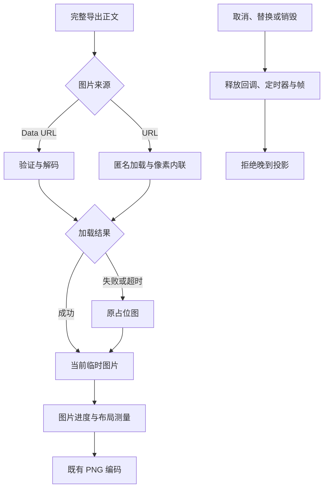

# R14-14 Asset Preloader

状态：**已实现；首轮 Windows 累计验证未通过，修复架构误报后待复验**；14.14不勾选，14.15未开始。唯一分支`agent/r14-stage`，基线为13正式验收提交`f4e5d5ed64e27216a0152736ff8d0f21f87f488e` / [CI38197683019](https://github.com/uniquenesssta/mdr/actions/runs/38197683019)。[13正式验收](R14-13-DETAILS.md#正式验收2026-10-12)与原实施历史保留。

## 13收尾证据

七组Windows及全部步骤通过，全仓2009/2009（339文件16目录）、前端1004/1004、布局33/33、PDF33/33、Word29/29、HTML36/36、Markdown30/30、浏览器11/11＋59/59、Rust281/格式/Clippy/check、实际Windows导入8/8、最终同提交`accepted=true`。前端、递归Node、Rust和最终收尾四ZIP实际下载并核对SHA-256；五比例、快速4:5→1:1替换、1080×3538长图/1080×1920裁剪及完整正文、释放JSON独立检查，前缀不同像素为0。原数学PNG零差及重复文本正控保持，不以接口证据宣称原生打印对话框或用户另存文件验收。

## 独立资源所有者

`formats/image/image-asset-preloader.js`只拥有图片预载任务、Image回调、期限和让帧句柄；没有文档、任务、布局、编码或文件权威副本。`prepare({root, task, isCurrent})`返回冻结的total/inline/loaded/failed摘要；任务进度仍由唯一Task Controller持有，文档版本只通过调用者提供的只读有效性判定检查。

| 来源或结果 | 当前行为 |
|---|---|
| 有效Data URL | 验证可加载并等待实际目标解码，保留原字符串和SVG，不重新编码 |
| URL图片 | 保留旧anonymous跨域模式与`_cors`缓存参数，正确保留query和fragment；成功像素通过临时Canvas转成内联PNG |
| Blob URL | 保留完整对象URL，不追加破坏对象身份的query；不撤销调用者拥有的URL，成功像素同样内联 |
| 加载失败、CORS拒绝、空源、非法尺寸或像素转换失败 | 仅替换失败的临时图片为原有120×80中性SVG占位图，继续后续图片及全部正文 |
| 加载或目标decode一直不结束 | 每个外部等待10秒后结束；decode失败转占位图，占位图decode也有限期，单一资源不挂住全部导出 |
| 取消、任务/root替换、源版本变化、移除图片或修改src | 终止当前预载，拒绝过时投影；晚到回调或decode结果不能重写新图片 |
| 独立destroy或pagehide | 中断当前加载/decode/让帧，逐项释放回调、timer和frame；销毁后拒绝prepare |

只对完整Builder正文的临时图片更改src和去除srcset/sizes；不修改原Preview、Hybrid或模型内容，不放宽CSP，不增加凭据、代理、权限或网络抓取后端。匿名加载像素不可读时按资源失败处理，不能绕过Canvas跨域保护。临时Canvas在读取后归零释放像素；回调、期限和帧无论成功/失败/取消均释放，清理异常仍尝试其他独立字段并计入资源失败，不误记成功。

图片进度沿用`90 + round(done/total*5)`和`images`阶段，每8项让一帧；所有外部调用、进度重入及等待后复核任务/来源身份。空图片集合保持可导出。取消仍由公开token决定，预载不拥有第二份cancelable状态；PNG最终编码仍由原链进入96进度并锁定encoding。

`compatibility/classic-image-asset-port.js`只桥接prepare与唯一placeholder，挂载是只读、不可重复且可独立终态卸载；卸载不销毁所有者，并保留他人替代属性。main建立唯一owner/port，pagehide分别释放。经典脚本删除`prepareExportImages`、旧placeholder定义及其专用让帧函数，改为公共资源端口；后续Data Encoder、最终Image Exporter和UI职责保持原阶段接收。

## 原目的与新证据

已验收的43项characterization、31项request、22项cancellation、33项layout和原59个实际页面名称与顺序保持。原两项直接经典预载测试迁到同一公开端口，仍验证原SVG失败回退及取消后回调解绑/晚到成功不重写图片；没有删除或放宽目的、像素门槛、PNG库参数和二进制输出检查。

新增41项契约：能力与timeout输入、空正文、query/hash、原Data URL与实际decode等待、原SVG精确字节、失败与后续成功、Canvas创建/context/draw/跨域/无像素错误、空/损坏Data URL、加载/占位decode超时、task取消/替换/两种独立销毁、root替换与独立root、src/节点/文档来源过时、构造/draw重入、进度/让帧取消、晚到decode拒绝、只读桥接/替代属性、真实经典调用至编码、Blob URL、清理异常和投影错误后的恢复。DOM/Image/Canvas替身只证明调度/边界，真实图片像素由以下Windows built-app场景证明。

新增两项实际页面，累计61：

1. Windows真实loopback第二origin提供有CORS图片、无CORS图片、404和不返回的图片，另含有效内联PNG。原图片命令在真实匿名加载、Canvas和10秒期限后调用原dom-to-image-more生成实际PNG；解码检查正常图片蓝色像素和三占位图灰色像素、完整尾段、1080×1920、95进度/encoding锁、原Preview节点和布局释放。匿名请求Origin及query保留，最终PNG阶段不再重取已内联图片。包装toPng仅记录并继续原编码，不替换编码结果。
2. 实际公开端口对目标decode等待执行取消、任务替换、源有效性变化与下一次成功预载；晚到结果保留后来设置的src并结束任务。原最终pagehide场景另挂真实pending decode，核对销毁拒绝、晚到结果隔离与端口移除；原pagehide全部断言和名称保留。

Windows工作流只追加一个image-assets专项步骤并更新标题；七组、递归全仓、前端全量、原实际场景、Rust门禁及最终同提交拒绝条件保持。新测试/构建/浏览器/Rust不在Linux环境作为产品验收执行，均交精确新head Windows。

## 工具与兼容核对

Context7仅查询dom-to-image-more图片内联与imagePlaceholder；返回main文档不冒充锁定版本保证，进一步核对实际锁定3.10.0源码`newImage().inline()`已对Data URL直接返回，不另发网络请求。PNG参数cacheBust/尺寸/背景/唯一placeholder保持。WHATWG [Canvas规则](https://html.spec.whatwg.org/multipage/canvas.html)与[图片decode规则](https://html.spec.whatwg.org/multipage/embedded-content.html)确认跨域像素失败及decode拒绝必须处理；不新增依赖。Mermaid Chart展示上面的中文真实链路，项目内保持同图。

## 当前验证和交接

本地仅进行语法、架构和记录等静态复核，结果保存在现有[精确范围记录](audit/r12-24-closeout.json)的`currentSourceReview.currentStageImplementation.staticReview`。544条生产模块清单保留原542条，72条风险路径保留原70条，原R12验收与阶段历史不覆盖；静态通过不等于Windows功能已通过。

14.14待新精确head七组Windows/累计全仓与61实际场景后才能验收；14.15 Data Encoder未开始，14.16最终Image Exporter和A10完整图片链、14.17 UI/经典删除保持接收。回退使用本任务基线f4e5d5e，不改变存储格式或数据库。启动Actions后结束会话，不轮询，约15～20分钟后查询。

## 首轮失败与修复（2026-10-12）

`8d925b3` / [CI38215675711](https://github.com/uniquenesssta/mdr/actions/runs/38215675711)已结束且失败。七组中六组成功，前端1045/1045、预载41/41、浏览器11/11＋61/61通过；全仓唯一直接失败为`tests/architecture/stage-09-editor-scroll-mapper.test.mjs:50`。最终汇总因repository-tests失败而正确拒绝，不能将实际图片场景通过等同本任务正式验收。

失败断言拼接Selection Controller与整个`src/main.js`，禁止所有`createElement('canvas')`，因14.14组合根为导出资源提供Canvas创建能力而触发。该能力只注入图片预载，实际drawImage/像素内联属于预载所有者；Sync依然使用EditorScrollMapper与CodeMirror几何能力，没有恢复旧textarea/Canvas文本测量。此结论来自失败日志、唯一Canvas位置与当前调用链，产品代码无需搬动来规避测试。

| 原断言目的 | 修复后的检查 | 保留与新增场景 |
|---|---|---|
| 防止Sync恢复Canvas全文测量与第二指标权威 | 五个Sync模块全部禁止Canvas创建；Sync与组合根一起禁止2D测量context、measureText、旧指标字段和重建函数 | 原mapper委托、core命令、经典脚本删除及销毁断言全部保留；新增正控拒绝单/双引号Canvas创建，以及Sync或组合根中的context、measureText、旧字段与重建函数 |
| 组合根只注入几何能力，不恢复编辑器指标所有者 | 原EditorScrollMapper公共工厂、几何委托、销毁及无window权威断言保持；允许组合根向独立图片预载注入DOM工厂 | 实际导出Canvas注入仍受新增静态正控核对；41项预载与61个真实页面场景保留 |

本轮只修改该架构检查及项目记录，未新增例外名单、跳过场景或修改产品、依赖、工作流。执行`node --test tests/architecture/stage-09-editor-scroll-mapper.test.mjs tests/architecture/stage-09-final-sync-legacy-removal.test.mjs`：17/17通过，这是源代码/清单静态审计，不能代替Windows产品复验。其余累计测试、真实图片和Rust由修复提交的七组Windows CI重验；14.14仍不勾选，14.15未开始。
