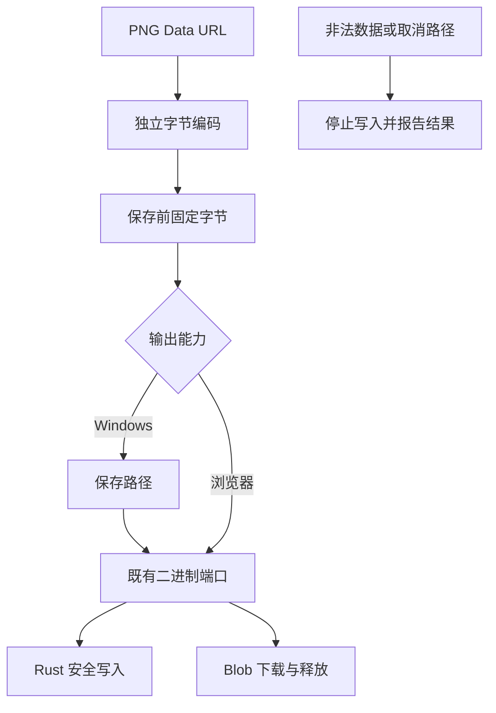

# R14-15 Data Encoder

状态：**已验收并正式收尾**（463af96 / CI38226523614）；14.15已勾选，用户已开始[14.16](R14-16-DETAILS.md)。唯一分支`agent/r14-stage`，实施基线为R14-14收尾提交`37920adbddd87d400440b131266ba943c95500b9`；前置产品验收为`b3d38cc` / [CI38217129135](https://github.com/uniquenesssta/mdr/actions/runs/38217129135)，七组及全部步骤通过。历史失败、收尾与验收数据保持。[14验收](R14-14-DETAILS.md#正式验收2026-10-12)。

## 职责和公共接口

`formats/image/image-data-encoder.js`公开`imageDataUrlToBytes(dataUrl)`及`ImageDataEncodingError`，只把Data URL变为调用者拥有的`Uint8Array`。它是无状态纯转换，不读取DOM、文档、任务或文件，不抓取网络，不拥有当前PNG缓存，也不需要人为创建start/destroy。`compatibility/classic-image-data-port.js`只公开只读encode能力，拥有独立可重复销毁的挂载生命周期；销毁后保留的encode方法拒绝调用，不删除他人替代属性。跨模块均走Export公共入口。

| 数据 | 处理结果 |
|---|---|
| PNG及其他Base64 Data URL | 按标准最终`;base64`标记处理，保留每个八位字节；支持大小写、空白和合法省略padding，非法字母/长度报编码错误 |
| 百分号编码 | 直接还原八位字节，不经decodeURIComponent或UTF-8文本解码；0x00/0x80/0xFF及非法UTF-8序列保持原字节 |
| 原Unicode文字 | UTF-8编码保留有效代理对；孤立代理项按标准标量转换为U+FFFD，BOM保持，不按charset参数重新转码 |
| 片段与嵌入逗号 | 按URL规则排除fragment，第一逗号后其余逗号仍是正文；百分号只解码一次，非法百分号序列保留字面值 |
| 非字符串、非data方案、缺少逗号、损坏Base64 | 明确编码错误，不执行用户对象toString，不在保存前产生输出副作用 |
| 长PNG或全部256种字节 | 字符展开限16384项，避免整个数组spread；每次返回独立数组，调用者之间不共享可变缓存 |

URL、百分号及最终Base64的顺序依据WHATWG [Data URL处理规则](https://fetch.spec.whatwg.org/#data-url-processor)；代理对/标量值依据[Encoding](https://encoding.spec.whatwg.org/#interface-textencoder)。现有URL/TextEncoder/atob能力足够，不新增生产依赖。输出是字节转换，并非图片重新编码或mime内容验证。

## 接入完整二进制输出链

经典图片命令删除私有`dataUrlToBytes`，改调用公共只读端口。点击保存时先转换并固定当前PNG字节，再打开Windows保存弹窗，避免弹窗等待期间新的预览覆盖这次数据。现有名称、过滤器、目录和用户取消行为保持；null/空路径取消不写入，无效路径或不完整平台能力报错。

Windows继续调用原Platform `files.writeBinary`，经现有客户端Base64封装到原Rust安全写入；浏览器也走该端口，使用原Blob下载与对象URL释放，mime为image/png。删除经典直接Data URL anchor链，不复制writer或URL清理实现。写入、点击或对话框失败不报成功，也不从Windows失败退到浏览器下载。

Mermaid Chart展示此实际连接，图同时保存在本任务书。原图片渲染/modal/source缓存编排由14.16接收，写入任务锁/销毁由14.16/14.17接收；本任务不提前复制最终Image Exporter或File Writer。已生成的预览与后续文档身份一致性不由无状态编码器拥有，不能把固定字节快照说成已完成最终图片所有者迁移。

## 原目的与验证映射

原43项characterization名称与场景保持；原3个私有转换断言改调用公开encode，仍验证无效输入报错、percent文本和PNG签名字节。命名/filter/目录、dialog取消、写入失败不回退的原场景保持。原61个实际页面名称、顺序和目的保留，最终pagehide追加编码端口销毁和移除断言。

新增58项契约定义覆盖数据来源/标记/字符/八位字节、全部256字节及262400字节长数据、独立输出、端口替代/销毁、真实Desktop FileSystemClient到Rust命令参数的65537字节边界、经典Windows/浏览器二进制输出、错误前置、弹窗数据快照、取消/无效路径及错误恢复。替身只证明对应调度或适配契约；真实文件证明见下面Windows链，未将替身记作真实落盘。

新增两项built-app页面，累计63：实际dom-to-image生成PNG，公共encode输出与原PNG逐字节一致，经原Platform/Blob下载后再读取并解码图片，检查PNG签名、Unicode名称、mime、尺寸和对象URL释放；实际Unicode/孤立代理项、原百分号二进制、损坏输入无URL副作用、anchor故障后的URL清理和下一次成功。捕获anchor只观察下载边界，不声称浏览器用户另存文件已经验收。

原Windows WebView harness额外执行`image-data-export.mjs`：公共encoder→实际Platform→原Rust安全写入→Node读取真实临时文件，核对65537字节全部256值、百分号八位字节、Unicode/孤立代理项、真实Canvas PNG的原始字节；实际目录目标拒绝后再次替换文件并逐字节核对。只使用已有harness拥有的临时根，finally继续原清理。无原生权限、CSP、IPC、依赖或Rust生产改动，原8个导入链和安全观察保持；新链失败直接使原WebView job失败。证据单独写入r14-15-native-image-data.json并进入原evidence归档。

## 当前验证和交接

本地只执行源码/脚本语法、架构/记录/清单门禁与差异静态检查；新产品Node、构建、浏览器、Rust和Windows原生二进制验证交新精确提交的Windows CI，不在Linux环境作为产品验收运行。58个测试回调只静态登记核对，未执行；两项页面表达式及pagehide的嵌入JavaScript另编译检查。

546行生产清单保留原544行；76项风险指纹保留原72个路径并加入编码器/端口/原生二进制harness链。历史验收与实现快照保持，实际静态结果进入[精确范围记录](audit/r12-24-closeout.json)的currentStageImplementation.staticReview。静态通过不表示58项契约或真实落盘已经通过。

回退基线37920ad；不改变模型、存储、数据格式或依赖。14.15必须取得新head的七组Windows与63实际场景/实际二进制文件证据后才能验收；14.16未开始，整体A10最终图片完整链仍由14.16接收。推送启动Actions后结束，不轮询，约15～20分钟后查询。

## 首轮Windows失败与修复2026-10-12

精确实施提交`c3e6a6a7a4500e7d24ed9288522691268a1a0efd` / [CI38223327955](https://github.com/uniquenesssta/mdr/actions/runs/38223327955)未通过。七组中全仓、依赖、实际Windows WebView、native opener、Rust成功；frontend的built-app步骤失败，最后汇总按门禁拒绝。58/58编码契约、1103/1103前端Node、11/11浏览器契约及生产构建通过；实际页面61/63成功，两个新增15场景均成功，失败为原14.10 HTML/14.11 Word的空文/Unicode/完整大正文场景，各报30秒Runtime.evaluate超时。15不验收。

frontend归档11735447667的SHA256为`2d219892bb8d5455a34a27f1c65fc42862a2679a3257441b5e8edd7dd28842cb`；WebView归档11735287618为`8df4eca497c5592fe2a2b33481bbf457e34a6553963c8c4c712bee141fe19d05`，下载后均按ZIP实际内容校验。实际Windows原二进制端口/Rust写入/Node读回的65537字节、256种percent字节、Unicode/孤立代理项、实际2×2 PNG全部逐字节一致；实际目录写入拒绝与后续替换恢复成功。原生证明只属于该失败head，不能代表新head或阶段累计验收。

两份失败截图均显示原450024 UTF-16单位大文档编辑/预览页面，没有导出进度。旧加载调用把实际导入、定位、视觉编辑、布局、再次定位及idle合为一次CDP请求；其五段idle预算为5+4+4+6+6=25秒，另含导入和多次长行布局/动画帧，接近未变的30秒传输上限。截图和旧日志尚不能独立确认究竟哪一步超过上限，也不能证明产品导出超时；因此本轮修复这个聚合请求边界，并补齐定位证据，不宣称已证明产品无性能问题。诊断中原已登记的Editor监听器错误保持原接收，未把它推断为这两次超时的原因。

仅在这两个完整正文场景中，测试准备仍走真实公开Document importTextContent、现有E2E位置/视觉/布局/idle能力，按原顺序和原单步预算拆为独立请求；普通夹具保持原加载链。原三个输入及90000次中文/emoji的同一450000单位长行保持，原全部导出/字节内容/字体/Preview身份/释放断言原样保留，新增准备完成的全量Editor/模型正文相等、选择位置、布局、ready及idle成功检查。没有使用替身导入、缩小正文、换行改变压力、提高CDP或导出期限、重试/跳过场景。每步及实际导出读取前后都写入r14-10-complete-html-setup.json/r14-11-complete-word-setup.json，包含阶段、正文长度、耗时、状态和失败原因，下一轮可以直接区分准备与导出边界。

本轮不改生产、工作流、Rust、依赖、阶段职责或七组门禁。静态门禁、语法、嵌入表达式、历史/指纹和原场景保留复核后，推送同一分支交新head Windows累计复验；14.15继续未勾选，14.16未开始。启动Actions后结束，不轮询，约15～20分钟后查询。

## 正式验收2026-10-12

`463af967b39d80b716ec6125985688e8db2b2ac0` / [CI38226523614](https://github.com/uniquenesssta/mdr/actions/runs/38226523614)七组Windows及全部步骤成功，全仓2109/2109（341文件、16目录）、前端1103/1103、编码58/58、浏览器11/11＋63/63、Rust281与原生导入8/8通过，最终精确提交accepted=true。实际PNG→公共encode→原Platform/Blob下载72994字节逐字节一致、1080×1920可解码且对象URL释放；Unicode/二进制、非法输入、点击故障后的释放和恢复通过。Windows原生四份实际文件（65537/256/20/93字节）读回一致，目录目标拒绝后下一次替换恢复通过。

两份HTML/Word完整大正文保留450024 UTF-16单位、90000次同一长行输入及原导出断言，48个准备/读取步骤全部通过。大正文初次定位6686/6263ms、布局13036/12403ms；最终实际导出读取25/23ms。新证据支持准备链长行布局耗时、拆分请求后恢复的判断；不把该head耗时写成稳定性能保证或替代旧失败缺失的阶段记录。

四个ZIP已下载并核对实际SHA256，所有76项精确来源指纹匹配；两张实际混合资源和数学PNG已视觉核对。归档ID/摘要、字节读回、准备逐步耗时和验收快照记录在[精确记录](audit/r12-24-closeout.json)的currentStageAcceptance/stageAcceptanceHistory。首轮失败、实现与修复记录保留。14.15正式收尾；最终Image所有者及A10完整图片链仍由14.16接收，本项成功不代表整个R14收官。
