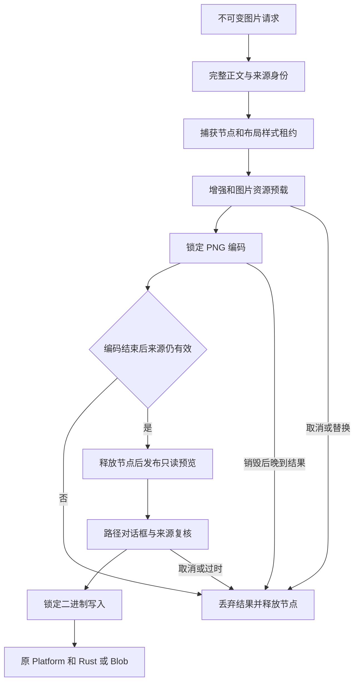

# R14-16 Image Exporter

状态：**已实现，待新精确提交Windows累计验证**；16未勾选，17未开始。唯一分支`agent/r14-stage`，基线为15收尾`b1c236b3326357c1c0f8d991d1f282dcd5582f77`。15已在`463af96` / [CI38226523614](https://github.com/uniquenesssta/mdr/actions/runs/38226523614)七组及全部步骤验收，首轮失败和修复保留。[15正式验收](R14-15-DETAILS.md#正式验收2026-10-12)。

## 职责与真实调用链

`formats/image/image-exporter.js`是图片工作流唯一所有者，公开`createImageExporter`，实例只读`render({request})`、`save({request})`、`getPreview()`和独立幂等`destroy()`。拥有当前PNG和已解码私有字节、对应文档ID/版本/会话generation、请求比例与裁剪快照、渲染revision和未结束操作。不导入vendor、经典全局、模型内部、平台内部、Worker或UI控制器；消费注入的公共能力。

`image-export-surface.js`独立拥有捕获DOM、Style/Layout租约与图片预览投影，不读模型、不建任务、不输出文件。挂载完整Builder正文，依次释放布局/样式并移除自己拥有的捕获节点；任一清理失败仍尝试其余清理，并阻止结果发布。不清空他人节点、不释放其他所有者的新任务。`classic-image-export-port.js`只挂载只读render/save/getPreview能力；销毁后保留引用拒绝调用，移除自己的属性，保留他人替代属性。

main组合根显式创建和接线，pagehide、初始化失败与Document feature销毁均按所有者→端口→Surface→其依赖清理。公共Export入口导出新模块；经典图片命令只创建不可变请求、提交render/save并投影状态/错误。删除`currentImageDataUrl`、旧图片正文/布局/增强/预载/PNG/缓存编排与经典二进制写入；比例按钮和modal壳暂保留由14.19接收的界面职责，通用File Writer仍由14.17迁移，未创建第二套Rust或浏览器writer。

Mermaid Chart已展示实际关系。Context7返回官方README的通用toPng Promise接口，针对3.10.0的查询未匹配；随后核对实际锁包和已安装官方源码：声明`^3.7.2`实际锁定**3.10.0**，保持不变。toPng经过异步克隆/资源/栅格化再canvas.toDataURL，没有AbortSignal/abort接口，因此不以取消一个等待Promise宣称已中断vendor转换。

## 取消、来源与副作用边界

| 阶段 | 行为与门槛 |
|---|---|
| 加载、Builder、Enhancer、资源准备 | 使用原Task token与独立停止信号，可取消/替换/销毁；异步后逐次复核ID、版本、generation及任务身份 |
| 最终PNG编码 | 调用vendor前锁encoding，Cancel按钮不可用，其他导出不能替换；真实Promise结束前保留捕获租约，结束后复核来源，晚到成功/失败都被观察 |
| PNG发布 | 确认PNG标记/签名字节并取得独立字节，全部捕获清理成功、任务结束后再复核来源/revision，才发布只读预览；清理失败不留“成功”缓存 |
| 读取预览、点击保存 | 过时来源清空缓存和图片投影；比例/裁剪不匹配拒绝旧图；保存弹窗前固定私有字节副本，外部快照无可写bytes能力 |
| Windows弹窗 | 等待可取消/替换；null/空路径是取消，不报成功；错误/无效路径不写、不降级浏览器；弹窗返回后再次复核来源/任务 |
| 二进制写入 | 调用前锁writing；原Platform→原Rust安全写入或原浏览器Blob/URL清理，错误不报成功；已经调用的写入不能保证abort或回滚 |
| 独立destroy/pagehide | 清空缓存/预览、终止可取消等待、拒绝后续使用，抑制晚到发布与成功；正在编码/写入的真实Promise仍观察到结束，独立destroy不会把其假称已取消 |

资源阶段增加明确90进入点，原逐图片91～95进度及10秒期限保持。PNG期间改变正文/切换文档或会话，即便vendor成功也不能发布对应旧图。捕获根释放后不替换原Preview/Hybrid，不临时reset预览。整个缓存最多一份PNG及字节，不把调用者快照或图片DOM当成第二个权威缓存。

## 原目的到新行为的映射

| 原检查 | 新接口/行为 | 保留的场景 |
|---|---|---|
| VM或实际页面直接赋值私有PNG缓存 | 使用真实公共render准备，再从冻结getPreview读取；无缓存setter | 原43 characterization与58 Data Encoder定义、名字、顺序保留；名称/filter/目录、dialog取消、写入失败、字节/MIME与URL释放继续 |
| 编码后检查仍挂载根的租约 | 观察编码时真正传入的捕获根，结束后检查租约解除且节点移除 | 5比例/长图/裁剪像素、编码锁定、失败/取消和恢复目的不变 |
| 数学PNG与移除MathML的参考对照 | 捕获真实生产根；确认已移除后只在测试中临时重挂、重施公共布局/样式生成参考，并自行移除 | 浅深色零像素差、可见额外文本正控、完整数学/Mermaid/任务/代码原断言保留 |
| 清理失败允许已发布PNG | 清理失败阻止缓存和预览发布，下一次成功恢复 | 原清理故障注入及所有租约/任务释放检查保持，加强失败不成功 |
| 弹窗等待时另一个预览到达仍输出旧图 | 只读快照不能改变字节；真实新渲染替换可取消保存任务，旧弹窗不写，下一次保存输出正确字节 | 保存前快照目的保持，并增加替换/来源保护；不设置新公共缓存setter以迎合旧测试 |
| 任意两字节作为PNG缓存测试底层输出 | 原Unicode/percent二进制仍经公共encoder→实际Platform边界检查；PNG命令只接受已渲染PNG | 损坏数据无URL副作用、点击失败释放、下一次同字节恢复保持 |
| 经典源码直接出现enhance/prepare | 检查经典提交公共Image端口，新owner消费公共Enhancer/Assets，并保留实际调用顺序观察 | 原Canonical Presentation和资源预载目的保持，禁止退休全局或复制renderer |

原63个built-app名称和顺序保留，最终pagehide新增Image端口/缓存/节点销毁观察；新增两项放在其前，累计65。原历史夹具和前置阶段验收原文不改写。

## 当前验证与证据定义

新增34项契约覆盖完整编排/当前来源/精确字节、私有只读缓存、来源ID/版本/generation/删除、比例/裁剪、编码锁定与节点租约保留、晚到成功/拒绝、准备取消/替换/独立销毁、Builder帧取消、阶段通知重入、加载/编码/解码/清理故障恢复、弹窗取消/编辑/替换/销毁、不可取消写入及晚到失败、端口替代/终态和经典旧所有者移除。VM/vendor/platform替身只证明调度与接口，不作为真实PNG或文件证据。

新增实际页面：真实math/Mermaid/Unicode PNG在锁定转换期间修改正文，拒绝旧输出且下一次完整PNG使用当前版本；vendor编码故障及实际anchor点击故障释放真实DOM/任务/URL，原renderer恢复后PNG Blob逐字节一致。归档r14-16-stale-encoding.json、r14-16-output-recovery.json及discarded/recovered/downloaded实际PNG，验收需查看图片和核对内容，不仅确认可解码。

原Windows WebView/import/security harness保留，并追加`image-export-chain.mjs`：实际Document导入→Image Exporter→原dom-to-image PNG→公共编码→实际Platform/Rust→Node真实文件读回；核对逐字节、PNG签名、1080×1920、目录目标失败及再次替换、来源变化前置拒绝。仅将原native save dialog结果自动指向harness临时根，实际交互式对话框/用户选路不作验收宣称；原renderer、IPC二进制、安全writer不替换。包装恢复原invoke属性，finally仍由原harness清理临时根。任何新链失败仍使原job失败，证据r14-16-native-image-export.json进入原归档。

549行清单保持原546行，80风险指纹保持原76路径并加入3个新生产模块及完整原生harness；四个受影响来源指纹按当前内容更新。历史验收/实现前缀保留，15验收独立保留。[精确范围记录](audit/r12-24-closeout.json)的currentStageImplementation记录真实静态结果与未验收边界。

本地仅做静态语法/嵌入表达式、架构/清单/文档门禁、依赖/Rust/模型未改和差异复核；不在Linux运行产品Node、build、浏览器或Rust验收。新head必须取得七组Windows、65实际页面及完整原生图片文件证据后才可勾16、关闭对应完整PNG门槛，当前不宣称整体A10关闭。17 File Writer未开始。回退基线b1c236b，存储格式和依赖保持；推送Actions后结束，不轮询，约15～20分钟后查询。
