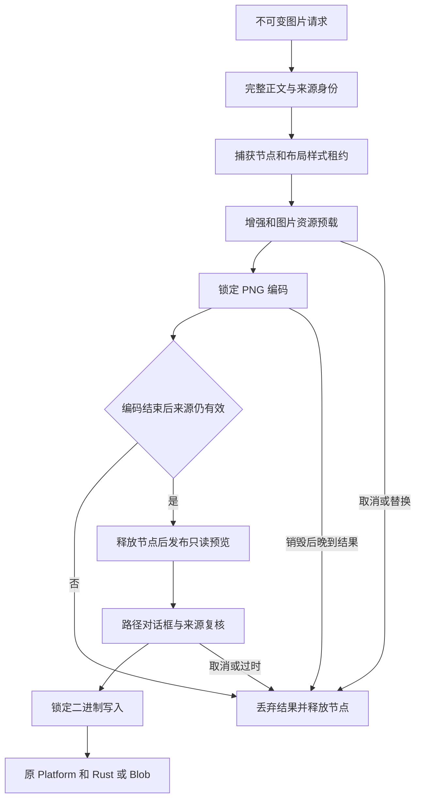

# R14-16 Image Exporter

状态：**正式验收收尾**；16已勾选，17按用户指令准备开始。唯一分支`agent/r14-stage`，基线为15收尾`b1c236b3326357c1c0f8d991d1f282dcd5582f77`。15已在`463af96` / [CI38226523614](https://github.com/uniquenesssta/mdr/actions/runs/38226523614)七组及全部步骤验收，首轮失败和修复保留。[15正式验收](R14-15-DETAILS.md#正式验收2026-10-12)。

## 职责与真实调用链

`formats/image/image-exporter.js`是图片工作流唯一所有者，公开`createImageExporter`，实例只读`render({request})`、`save({request})`、`getPreview()`和独立幂等`destroy()`。拥有当前PNG和已解码私有字节、对应文档ID/版本/会话generation、请求比例与裁剪快照、渲染revision和未结束操作。不导入vendor、经典全局、模型内部、平台内部、Worker或UI控制器；消费注入的公共能力。

`image-export-surface.js`独立拥有捕获DOM、Style/Layout租约与图片预览投影，不读模型、不建任务、不输出文件。挂载完整Builder正文，依次释放布局/样式并移除自己拥有的捕获节点；任一清理失败仍尝试其余清理，并阻止结果发布。不清空他人节点、不释放其他所有者的新任务。`classic-image-export-port.js`只挂载只读render/save/getPreview能力；销毁后保留引用拒绝调用，移除自己的属性，保留他人替代属性。

main组合根显式创建和接线，pagehide、初始化失败与Document feature销毁均按所有者→端口→Surface→其依赖清理。公共Export入口导出新模块；经典图片命令只创建不可变请求、提交render/save并投影状态/错误。删除`currentImageDataUrl`、旧图片正文/布局/增强/预载/PNG/缓存编排与经典二进制写入；比例按钮和modal壳暂保留由14.19接收的界面职责，通用File Writer仍由14.17迁移，未创建第二套Rust或浏览器writer。

Mermaid Chart已展示实际关系。Context7返回官方README的通用toPng Promise接口，针对3.10.0的查询未匹配；随后核对实际锁包和已安装官方源码：声明`^3.7.2`实际锁定**3.10.0**，保持不变。toPng经过异步克隆/资源/栅格化再canvas.toDataURL，没有AbortSignal/abort接口，因此不以取消一个等待Promise宣称已中断vendor转换。

## 取消、来源与副作用边界

| 阶段 | 行为与门槛 |
|---|---|
| 加载、Builder、Enhancer、资源准备 | 使用原Task token与独立停止信号，可取消/替换/销毁；异步后逐次复核ID、版本、generation及任务身份 |
| 最终PNG编码 | 调用vendor前锁encoding，Cancel按钮不可用，其他导出不能替换；真实Promise结束前保留捕获租约，结束后复核来源，晚到成功/失败都被观察 |
| PNG发布 | 确认PNG标记/签名字节并取得独立字节，全部捕获清理成功、任务结束后再复核来源/revision，才发布只读预览；清理失败不留“成功”缓存 |
| 读取预览、点击保存 | 过时来源清空缓存和图片投影；比例/裁剪不匹配拒绝旧图；保存弹窗前固定私有字节副本，外部快照无可写bytes能力 |
| Windows弹窗 | 等待可取消/替换；null/空路径是取消，不报成功；错误/无效路径不写、不降级浏览器；弹窗返回后再次复核来源/任务 |
| 二进制写入 | 调用前锁writing；原Platform→原Rust安全写入或原浏览器Blob/URL清理，错误不报成功；已经调用的写入不能保证abort或回滚 |
| 独立destroy/pagehide | 清空缓存/预览、终止可取消等待、拒绝后续使用，抑制晚到发布与成功；正在编码/写入的真实Promise仍观察到结束，独立destroy不会把其假称已取消 |

资源阶段增加明确90进入点，原逐图片91～95进度及10秒期限保持。PNG期间改变正文/切换文档或会话，即便vendor成功也不能发布对应旧图。捕获根释放后不替换原Preview/Hybrid，不临时reset预览。整个缓存最多一份PNG及字节，不把调用者快照或图片DOM当成第二个权威缓存。

## 原目的到新行为的映射

| 原检查 | 新接口/行为 | 保留的场景 |
|---|---|---|
| VM或实际页面直接赋值私有PNG缓存 | 使用真实公共render准备，再从冻结getPreview读取；无缓存setter | 原43 characterization与58 Data Encoder定义、名字、顺序保留；名称/filter/目录、dialog取消、写入失败、字节/MIME与URL释放继续 |
| 编码后检查仍挂载根的租约 | 观察编码时真正传入的捕获根，结束后检查租约解除且节点移除 | 5比例/长图/裁剪像素、编码锁定、失败/取消和恢复目的不变 |
| 数学PNG与移除MathML的参考对照 | 捕获真实生产根；确认已移除后只在测试中临时重挂、重施公共布局/样式生成参考，并自行移除 | 浅深色零像素差、可见额外文本正控、完整数学/Mermaid/任务/代码原断言保留 |
| 清理失败允许已发布PNG | 清理失败阻止缓存和预览发布，下一次成功恢复 | 原清理故障注入及所有租约/任务释放检查保持，加强失败不成功 |
| 弹窗等待时另一个预览到达仍输出旧图 | 只读快照不能改变字节；真实新渲染替换可取消保存任务，旧弹窗不写，下一次保存输出正确字节 | 保存前快照目的保持，并增加替换/来源保护；不设置新公共缓存setter以迎合旧测试 |
| 任意两字节作为PNG缓存测试底层输出 | 原Unicode/percent二进制仍经公共encoder→实际Platform边界检查；PNG命令只接受已渲染PNG | 损坏数据无URL副作用、点击失败释放、下一次同字节恢复保持 |
| 经典源码直接出现enhance/prepare | 检查经典提交公共Image端口，新owner消费公共Enhancer/Assets，并保留实际调用顺序观察 | 原Canonical Presentation和资源预载目的保持，禁止退休全局或复制renderer |

原63个built-app名称和顺序保留，最终pagehide新增Image端口/缓存/节点销毁观察；新增两项放在其前，累计65。原历史夹具和前置阶段验收原文不改写。

## 当前验证与证据定义

新增34项契约覆盖完整编排/当前来源/精确字节、私有只读缓存、来源ID/版本/generation/删除、比例/裁剪、编码锁定与节点租约保留、晚到成功/拒绝、准备取消/替换/独立销毁、Builder帧取消、阶段通知重入、加载/编码/解码/清理故障恢复、弹窗取消/编辑/替换/销毁、不可取消写入及晚到失败、端口替代/终态和经典旧所有者移除。VM/vendor/platform替身只证明调度与接口，不作为真实PNG或文件证据。

新增实际页面：真实math/Mermaid/Unicode PNG在锁定转换期间修改正文，拒绝旧输出且下一次完整PNG使用当前版本；vendor编码故障及实际anchor点击故障释放真实DOM/任务/URL，原renderer恢复后PNG Blob逐字节一致。归档r14-16-stale-encoding.json、r14-16-output-recovery.json及discarded/recovered/downloaded实际PNG，验收需查看图片和核对内容，不仅确认可解码。

原Windows WebView/import/security harness保留，并追加`image-export-chain.mjs`：实际Document导入→Image Exporter→原dom-to-image PNG→公共编码→实际Platform/Rust→Node真实文件读回；核对逐字节、PNG签名、1080×1920、目录目标失败及再次替换、来源变化前置拒绝。仅将原native save dialog结果自动指向harness临时根，实际交互式对话框/用户选路不作验收宣称；原renderer、IPC二进制、安全writer不替换。仅包装并恢复原fetch属性；原invoke/ipc不改写，finally仍由原harness清理临时根。任何新链失败仍使原job失败，证据r14-16-native-image-export.json进入原归档。

549行清单保持原546行，80风险指纹保持原76路径并加入3个新生产模块及完整原生harness；四个受影响来源指纹按当前内容更新。历史验收/实现前缀保留，15验收独立保留。[精确范围记录](audit/r12-24-closeout.json)的currentStageImplementation记录真实静态结果与未验收边界。

本地仅做静态语法/嵌入表达式、架构/清单/文档门禁、依赖/Rust/模型未改和差异复核；不在Linux运行产品Node、build、浏览器或Rust验收。新head必须取得七组Windows、65实际页面及完整原生图片文件证据后才可勾16、关闭对应完整PNG门槛，当前不宣称整体A10关闭。17 File Writer未开始。回退基线b1c236b，存储格式和依赖保持；推送Actions后结束，不轮询，约15～20分钟后查询。

## 首轮Windows失败与修复2026-10-12

`43bc086a98ae1456ad5307fd94f63b1faa801d5a` / [CI38238244716](https://github.com/uniquenesssta/mdr/actions/runs/38238244716)未通过：Rust、原生编译、依赖三组成功；全仓Node、frontend、WebView构建及最终汇总失败。图片所有者34/34、编码58/58、原characterization43/43、浏览器契约11/11通过；前端1132/1137、累计全仓2134/2143，原真实页面65项未到执行，原生完整PNG新链也未执行。不能以34项替身契约通过表示图片链验收。

失败构建两次报告同一主业务包704049字节，超过既有700000异步预算4049字节；built-app诊断只有根页面和favicon两个404，无console/exception，随后app-ready等待超时，是未产出dist页面的后续失败，不增加等待期限。已下载frontend归档11740719752（2346951字节），实际ZIP SHA256为`b4ea8913e40b8cba54dc5b21a8060c8ff8d78d3ecdf48be3981a534102997d39`。其中image-exporter.log明确34/34，故障日志及诊断与上述分类一致；没有新PNG/实际文件证据可作验收。

| 直接失败 | 根因与修复 | 原门槛保持 |
|---|---|---|
| bundle-budget / WebView build | 新独立Image模块进入已有主业务chunk，超过上限；把无外部依赖的图片模块、公共请求策略、Task模块及图片只读桥接组成export-image chunk | 入口500000/异步700000、已有vendor分配和加载时机保持，不提高预算或绕过插件 |
| invalid-input前置场景 | 迁移私有缓存setter时多调用一次render准备，本场景的坏输入因此产生两次toast；删除这次无关准备，只调用原被测入口 | 六个原入口与坏名称/无文档场景保持，原单toast、零task/快照/vendor/打印/文件断言保留，并要求toast明确为参数无效，不能由“先生成预览”等提示冒充输入拒绝 |
| Asset fallback/success两场景 | 旧夹具将图片挂到“第一个div”，现在第一个是Builder正文，真正捕获根在Surface后创建；按实际preview-content捕获根供给查询 | 原匿名loader、成功内联/占位图、PNG前锁定、回调/定时器释放及两种结果断言保持，新增确为PNG根且loader实际启动检查 |
| Document Session/Controller旧源码检查 | 经典脚本已删除不再调用的直接文档端口；改核对只读Image端口→main注入公开DocumentController→新owner读取activeId/record/generation | 冻结模型hash、单一会话/生命周期所有者及禁止经典全局/直接状态写入断言保持，不恢复无用绑定来迎合字符串 |
| Platform Dialog/Cutover旧源码检查 | 桌面dialog/write已由公共Image owner调用；改核对经典只读Image入口和owner的公开Platform调用 | 原Platform边界、禁止native全局/Tauri侵入和其他经典调用者断言保持 |
| README/LoadController文档检查 | 上轮状态更新漏掉docs/README索引，并覆盖了15收尾历史条目；从已验收b1c236b恢复精确Change Log前缀，另保留16实施/失败记录 | 不改旧文档测试或LoadController职责；真实索引链接恢复、历史前缀一致 |

实际锁定Vite7.3.6/Rollup4.62.2保持。Context7核对[官方manualChunks规则](https://rollupjs.org/configuration-options/#output-manualchunks)：函数形式默认吸收依赖，可能影响副作用时序。本轮只选择源码依赖闭合的请求/Task/Image集合；它们所有静态导入仍落在同一chunk，UI/Preview/Platform及vendor继续原图，不新增main→feature→main回路，也不全局改onlyExplicitManualChunks策略。不是改变业务职责或增加新生产模块；所有模块仍从原公共入口接线。Mermaid Chart展示该代码边界与运行时能力注入。

新增2项构建配置审计：从实际文件导入验证chunk闭合及共享模块仍不入该包；调用原bundle gate，以入口/异步恰好达限、超出1字节、入口导入图片chunk三类检查确认原阈值仍生效。9项相关文档、配置和文档/平台公共边界静态检查通过；这些只读取源码/配置与冻结hash，不运行应用行为、构建、PNG或原生写入，不能替代Windows产品验收。其余修改的脚本语法、清单/指纹/历史及四门禁由repair.staticReview登记。

549模块与80风险路径保持，只有Vite配置的已审阅来源指纹变化；原34项Image契约、58项字节、65实际页面和七组Windows门槛继续全部执行。无业务生产逻辑、依赖、Rust、冻结模型、图片cache或写入实现改动。16保持未勾选，17未开始；新精确head必须先实际构建再取得完整页面和原生PNG读回证据。推送Actions后结束，不轮询，约15～20分钟后查询。

## 第二轮Windows失败与修复（2026-10-12）

`b7bfe8610402360173c9d442b04bb4fbae7d91f4` / [CI38245940820](https://github.com/uniquenesssta/mdr/actions/runs/38245940820)未通过，七组中四组成功。上轮全部直接问题已消除：前端1139/1139、全仓2145/2145（16目录）、新Image34/34、Data58/58、原characterization43/43、浏览器11/11＋65/65、Rust281及Clippy通过；Windows构建成功，main约678.23kB与Image约26.09kB均在原预算内。不能将四组成功登记为16验收。

| 本轮直接失败 | 修复与保留门槛 |
|---|---|
| Official scanner下载返回HTTP504，尚未开始RustSec扫描 | 同一官方URL最多4次，每次120秒超时，退避1/2/4秒。仅408/429/500/502/503/504及网络/读取超时重试；HTTP永久错误、编程错误立即失败。每次状态/错误/退避与最终SHA256记入证据，固定摘要不符立即失败；四次失败仍非零退出，不使用缓存替代、镜像或忽略公告。原数据库、版本、锁文件、扫描/分类和累计门槛不变。新增5项契约在Windows执行，原8项定义及顺序保留。 |
| 完整原生PNG已render，但夹具试图Reflect.set不可写invoke，未到达完整图片save | 核对实际锁定JS API2.11.1、dialog2.7.1、Rust Tauri2.11.5；Context7返回通用官方实现，另读取[精确2.11.5 core](https://github.com/tauri-apps/tauri/blob/tauri-v2.11.5/crates/tauri/scripts/core.js)与[协议源码](https://github.com/tauri-apps/tauri/blob/tauri-v2.11.5/crates/tauri/scripts/ipc-protocol.js)：invoke/ipc/postMessage以默认描述符定义。夹具只匹配convertFileSrc生成的save命令URL及POST，按原JSON响应协议返回harness路径，原invoke和回调继续执行；所有其他fetch参数原样调用原fetch。三个write_local_binary_file请求计数且必须真实读回，finally恢复原fetch并验证invoke不变；不调用mockIPC、不替换整对象、不更改生产Tauri/Platform/权限。 |

原生链保留实际Document导入、真实PNG生成、完整1080×1920字节、目录目标拒绝、后续同目标替换、编辑来源后的零新增dialog、缓存/任务/捕获释放。通过全部断言后把真实读回字节另存`r14-16-native-image-export.png`到原Windows证据归档，临时文件根仍由原harness finally删除。仅自动化保存对话框协议结果，不宣称交互式对话框/真实用户选路通过；如果原协议转入不支持的postMessage路线，本测试仍失败，不能以模拟原生写入替代。

前端归档11746631052，SHA256 `5fc8f934d96fab89ed8d18c8559738171860ff2883eddf9869917ff450e03c12`；WebView归档11745387592，SHA256 `b790f949ba8b0063871c8b68e1ebf6a369a745b1ea550615d5bf03688d09aa03`，均实际下载校验。新增stale-encoding/recovery两份JSON已核对锁定、编辑拒绝、恢复及释放；真实recovered长图含当前标题、Unicode、表格、任务、完整代码、两段公式和Mermaid，downloaded恢复图含正确公式/尾文，无额外MathML文本。WebView原14.15四文件真实读回仍成功，完整14.16图片读回未成功，不能关闭A10。

本地仅进行源码/配置/文档静态审计及语法编译，不运行应用产品测试、build、PNG或Rust。新下载行为和原生fetch响应包装必须在新精确head Windows复验，所有65页面/34图片/58字节场景、七组及预算保持。Mermaid Chart展示修复后的真实传输边界，完整所有者架构不变；16未勾选、17未开始，启动Actions后结束不轮询。

本轮静态复核：8项配置/文档/源码门槛、四架构门禁通过，4脚本语法及1个修改后的WebView表达式只编译不执行，174链接和80指纹一致；549模块清单、原场景与前置验收历史不变。新下载5项和原生链未在本地执行；第一次外部解析器查找不可用，改用内建vm.Script完成表达式编译。

## 正式验收（2026-10-12）

`1c211b961f1ef725ce51bf84bdee217a690a1b12` / [CI38257846018](https://github.com/uniquenesssta/mdr/actions/runs/38257846018)七组Windows及全部步骤成功：全仓2150/2150（16目录）、前端1144/1144、Image34/34、Data58/58、旧characterization43/43、浏览器11/11＋65/65、Rust281和Clippy、最终accepted=true。固定官方扫描器200返回且摘要一致，原完整RustSec/Windows graph判断成功；新5项下载契约通过。

实际原生PNG80632字节，1080×1920，SHA256 `00a08f3da872e29575e1367b2de31c540a64a79cf76af954c65ccfcc02710e37`；读回与原真实renderer PNG逐字节一致，目录失败/下一次替换、过时来源零新dialog、原invoke保持、三个实际二进制传输及所有缓存/任务/节点释放通过。已检查实际PNG，包含Windows完整图片标题、Unicode、正确公式与KEEP NATIVE TAIL，无重复MathML辅助文本。原14.15四文件读回和导入/安全链继续通过。

| 已下载校验归档 | SHA256 |
|---|---|
| 11751606174 前端 | 78118a5352328a23ab3d1d8ba0afff7c12e7c8d4871f72a779201c9869614663 |
| 11751131669 WebView | cec8f5ad19147cd95d0327d564096dd51ff2a32c6e5648ad77d7ed76f4f88c4d |
| 11751041402 全仓 | 04cd7ca1dd4933b27945053a0fa4027c1c3c7e1b7d5468e97843a0c8699c4925 |
| 11750824151 依赖 | 6d3486f035a260c9c0412cc398e7d5be55c6ee1eb14250dff102401973acac9a |
| 11752120542 最终汇总 | 3df4253ce01f7d139ec678b1ccefc25683a8d517cc85113cb8b84a4b59e54de1 |

16验收完成，完整PNG/增强来源与A10图片子门槛有真实证据；A06统一格式File Writer由17补齐，整个R14收官仍有后续职责。两轮失败及各修复保留；仅自动化dialog结果不代表交互式选路通过，已开始编码/写入的abort或回滚保证仍不成立。
