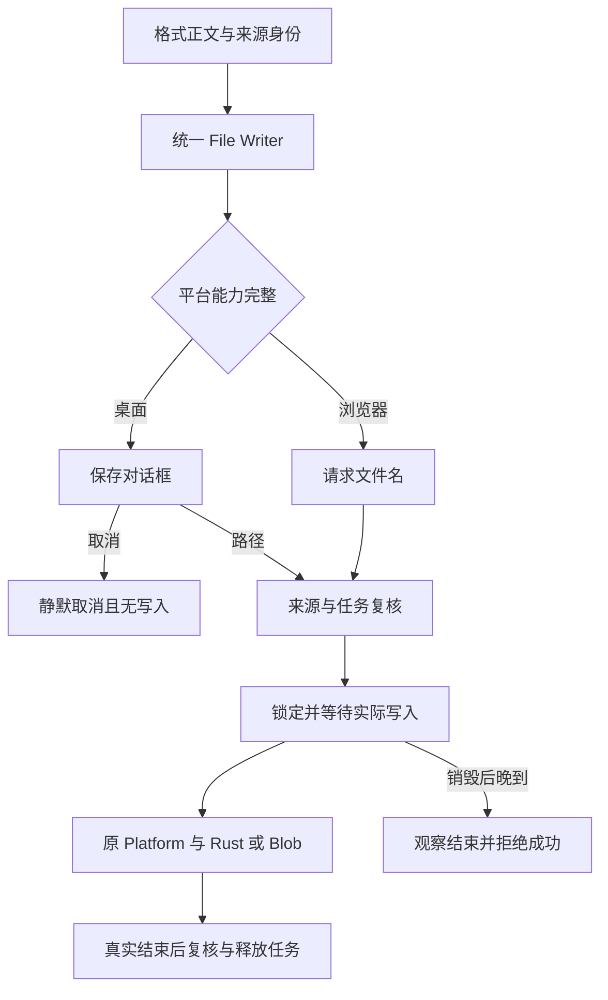

# R14-17 File Writer

状态：**实现完成，待新精确提交Windows累计验证**；17未勾选，18未开始。唯一分支`agent/r14-stage`，16收尾基线`19de94351498a64ba13af704c00c51a65e14c718`。16已在`1c211b9` / [CI38257846018](https://github.com/uniquenesssta/mdr/actions/runs/38257846018)七组及全部步骤通过，全仓2150/2150、前端1144/1144、图片34/34、编码58/58、浏览器11/11＋65/65、Rust281与实际完整PNG逐字节读回；两轮失败及修复保留。[16验收](R14-16-DETAILS.md#正式验收2026-10-12)。

## 唯一职责与调用链

新增公共`application/export-file-writer.js` / `createExportFileWriter`，实例只提供`write`和独立幂等`destroy`。统一Markdown/HTML/Word/PNG的输出能力完整性判断、保存dialog参数、目标路径、取消结果、浏览器MIME、文本/二进制方法分派，以及实际写入前后的来源/任务屏障。main只创建一份并显式注入四个格式所有者，公开Export入口导出；格式里删除所有nativeDialogs/nativeFiles、dialog和write重复编排。VM及原定向测试也使用真正公共Writer，不补隐藏旧绑定。

内容读取/渲染/PNG缓存、当前文档ID/版本/generation、Task begin/finish和成功消息仍分别由格式所有者承担。Writer消费调用方的task、assertCurrent、wait，自己只拥有待结束dialog/操作的停止信号；不创建第二份任务/文档/cache，不读UI或原生全局。原Platform仍独立拥有浏览器Blob/anchor/URL清理与原生运输；原Rust原子替换、目标占用拒绝、原文件保留和临时文件清理算法完全不变。PDF仍是独立print owner，Document Save/Autosave属于原持久化流程，不调用文件导出Writer。

Mermaid Chart已展示真实关系。没有新生产依赖，也没有修改支持环境。实际锁包Tauri JS2.11.1/dialog2.7.1/Rust2.11.5继续16已验证的协议；测试仍只包装并恢复fetch，原invoke/ipc保持。

## 生命周期与保留契约

| 边界 | 当前行为 |
|---|---|
| 请求/内容 | 使用原公共不可变请求策略；text必须string，PNG必须Uint8Array；Binary在任何await前独立复制，外部修改不能改变输出 |
| 能力 | desktop dialog/files必须同时可用，或完整browser download；半套桌面能力失败，不退回浏览器 |
| dialog | 保留原名称、扩展名、filter、标题及自定义目录；null/空路径返回cancelled，经典UI不报错或成功；异常/无效路径不写 |
| 异步等待 | 原调用方wait/token与Writer独立停止信号共同保护dialog；取消/替换/来源变化/独立destroy阻止后续写入并消费晚到拒绝 |
| 不可取消写入 | 实际调用前lock writing、通知后再次复核；await原write Promise，不竞速停止信号。真实完成后再次检查来源与销毁，才允许成功 |
| 错误/清理 | 当前错误保持identity；过时/销毁后的晚到成功或错误归为取消；不重复写入、不声称回滚。格式finally只结束自己持有的任务 |
| 所有者销毁 | 独立格式destroy不销毁共享Writer；pagehide、初始化失败和Document feature销毁按格式→Writer→Task及依赖释放。开始后的write仍被观察 |

修复已确认的相邻文本输出缺陷：Markdown/HTML/Word旧destroy会竞速已开始写入并提前finish，允许同一任务体系另起输出。三条原场景名称及resolve/reject输入保留，改为先确认writing锁与竞争任务拒绝，真实Promise结束后再拒绝晚到结果。图像16已使用真实settlement屏障，本轮统一到Writer。这个变化不宣称已停止磁盘I/O。

## 测试迁移映射与新证据

| 原目的 | 新接口检查 | 场景保留 |
|---|---|---|
| 格式单元测试直接注入platform | 注入真实createExportFileWriter，仍修改原platform故障/能力并观察相同输出 | 原Markdown/HTML/Word/Image、43经典和58编码名称/顺序/数据保持；3写入销毁场景增强真实结束后释放 |
| Image直接调用Platform的源码字符串 | Classic→Image公共owner→Writer→原Platform；main显式同实例注入 | 原native/global facade/plugin导入禁令及Dialog单所有者检查不变 |
| 原Image/Request/Task闭合chunk | 同包增加只有公共Request/Task静态依赖的Writer | 原UI/Preview/Platform/vendor归属及500000/700000字节预算不变，原4构建配置审计继续 |

新增29项Writer契约定义：四格式桌面/浏览器精确payload/profile、四格式null/空路径静默取消、取消/替换/destroy/来源变化时的dialog、四格式已开始写入的晚到resolve/reject、外部字节修改、能力缺损/坏路径/错误payload、错误identity与恢复、同步锁定重入及唯一公共调用链。只静态注册了29个唯一名称，本地没有执行产品回调。

新增真实页面1项，累计66：四个最终格式命令在实际anchor故障时清理URL/节点/任务，之后恢复并捕获正确MIME和完整内容或PNG精确字节；归档`r14-17-shared-writer-browser.json`。原65项顺序保持，最终pagehide仍最后运行。

新增`tests/e2e/windows/file-writer-chain.mjs`进入原WebView硬门槛：实际Document导入与PNG→各最终格式owner→同Writer→原native text/binary IPC与Rust→Node真实读回；逐字节对比实际IPC文本/Base64输入。四格式分别测试null选路无写入、先写harness原文件、外部PowerShell持有Windows独占句柄后实际输出拒绝、原文件保持、关闭句柄后再次恢复、无临时文件残留。真实产物`r14-17-native-writer.md/html/doc/png`与`r14-17-native-file-writer.json`进入原归档。

PowerShell使用现有Windows PowerShell的.NET Framework File.Open/FileShare.None与finally Dispose，仅打开自有临时文件、不触碰用户路径。Context7只给出通用FileStream清理文档，未匹配精确独占接口；随后核对[Microsoft FileShare文档](https://learn.microsoft.com/dotnet/api/system.io.fileshare)：None拒绝后续打开直到句柄关闭，此API适用于.NET Framework。原harness终于清理ownedRoot；新增子进程获取/释放均有期限，失败仍阻断job。仅save协议响应自动返回自有路径，不宣称交互式对话框/实际用户选路已验收。

## 当前审查与剩余门槛

生产清单550行，原549路径及顺序保持，三个已迁移格式职责描述更新；风险清单82路径，原80保留，增加Writer与原生helper，真实变更指纹逐项登记。无Rust/模型/依赖/存储格式改动。工作流保留七组全部Windows gate，新增29项定向Writer步骤，原34/58/65全部继续执行。

本地只做源码、配置、文档、语法和表达式编译，不运行应用Node、build、浏览器、PNG或Rust验证。17验收、A06统一格式关闭与实际文件可靠性必须等待新精确head七组成功及四格式原生证据；不把16证据改写成17通过。18旧实现删除、后续UI迁移未开始。推送并确认Actions启动后结束，不轮询，约15～20分钟后查询。

本轮静态复核：10项源码/配置/文档审计及四架构门禁通过；17脚本语法、3个新增页面/WebView表达式只编译不执行，29项Writer名称静态注册无重复；183相对链接、82指纹、550清单、原场景名字/顺序及16完整验收/失败历史一致。产品回调未在本地执行。
