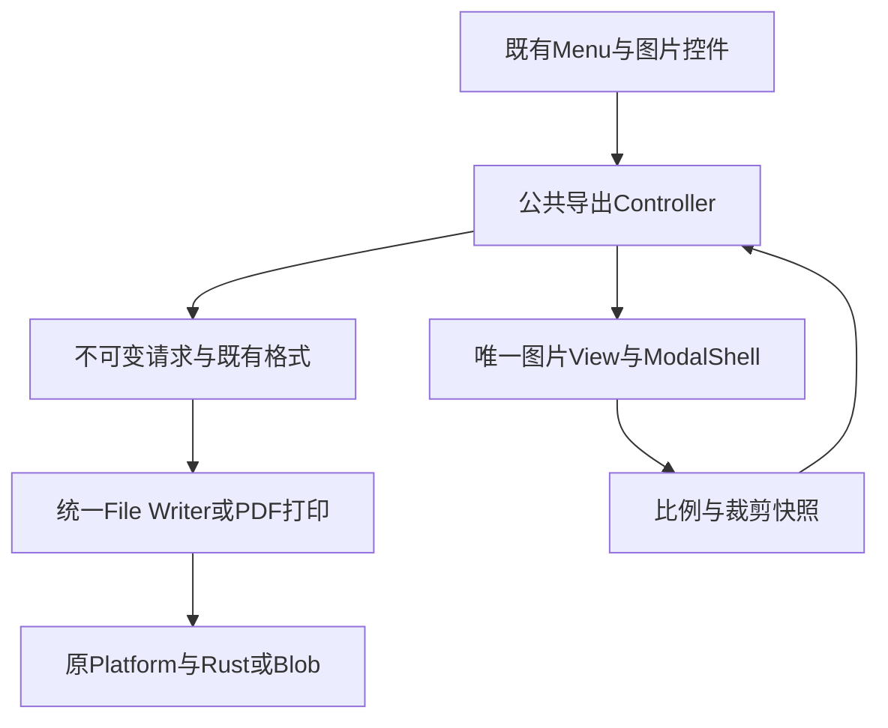

# R14-18 删除旧导出链

状态：**实施完成，Windows验收待验证**；14.18不勾选，整体R14/A10不提前收官。唯一分支`agent/r14-stage`，17收尾基线`b6aa0cf11610dd15e1a4b880ac9cfa585a2902a6`。17在`1e6f4ae` / [CI38268106587](https://github.com/uniquenesssta/mdr/actions/runs/38268106587)七组与全部步骤通过，全仓2179/2179、前端1173/1173、Writer29/29、图片34/34、编码58/58、浏览器11/11＋66/66、Rust281和四格式实际文件精确读回/占用失败原件保留/恢复均通过；A06已关闭。[17正式验收](R14-17-DETAILS.md#正式验收2026-10-12)。

## 唯一命令与界面所有者

`application/export-controller.js`拥有公开命令校验、不可变请求创建、格式分派、通知与终止生命周期；通过注入Request、Task、格式公开能力和View调用，没有PNG缓存、正文模板、Platform/Rust输出或classic全局查找。公开`has/invoke/destroy`；保留失败文案、取消静默、busy/no-preview提示和既有导出性能operation名称。

`ui/export-image-dialog-view.js`唯一创建图片ModalShell、五个比例按钮、crop控件、预览节点和隐藏捕获stage。View拥有展示比例与DOM选项，冻结其快照，委托公共命令；不编码、不持有PNG、不调用Writer。保留CSS/ID、两图标、十四个翻译绑定、初始焦点/Escape/backdrop/返回焦点；销毁移除节点与监听器，构造中失败回滚。

`compatibility/classic-export-command-port.js`只在既有业务宿主挂只读`markdownEditorExportCommandPort`，解绑仅删除同一实例，晚到调用拒绝，没有window别名。Menu Adapter的五种格式全部调用此端口；main显式组合Controller、原请求/任务、五个格式与View，Settings公开端口提供目录。先终止命令，再释放格式/Surface/View，最后公共Writer/Task，pagehide及初始化失败均清理。

Mermaid Chart已展示实际链路。本项使用已验收的项目ModalShell/Icon/DOM能力，没有新增第三方API或依赖，未触发额外Context7查询。任务书14.18是本阶段最后一个Atomic；旧交接中14.19仅作为历史保留，本轮不创建该任务。既有Menu View继续拥有菜单，不另建重复Export Menu。

## 删除与验证替代映射

| 原边界 | 当前实际边界 | 保留验证 |
|---|---|---|
| public/app/export.js加载与classic全局函数 | 文件及加载入口删除，公共Controller/scoped command唯一分派 | 删除门禁、Menu五命令公共端口回归、实际菜单点击，禁止恢复window别名 |
| 模板图片modal/stage与onclick/onchange | 唯一View创建DOM、显式事件作用域、直接ModalShell | 比例/crop/刷新/下载/关闭、焦点/ARIA、失败回滚与销毁；模板及registry禁止第二实例 |
| 模板五个导出onclick | 保留Menu需要的既有结构，删除inline；现有Menu View绑定公开command IDs | 所有格式仍同公共Controller；不改变菜单结构/命令数量 |
| 原VM与built-app旧名字调用 | 测试域显式映射真实公共命令；页面别名仅为每个表达式局部词法变量 | 原名称、顺序、输入、错误/取消/过时/完整输出与状态断言保留；新菜单场景完全不使用测试适配器 |
| 图标/翻译只计template | 图片View两icon及十四绑定纳入同一总量 | 全量仍47图标引用、113翻译绑定；实际图片DOM两href、十四绑定及英文切换严格检查 |
| 旧保存/平台source断言读export.js | Controller→真实格式→统一Writer→原Platform | 保存隔离、native facade/global/CSP/IPC禁用与错误/原件保留门槛保持 |
| 历史workflow/script检查已删文件 | 旧语法检查改查Controller，Platform证据另查Controller分派与Writer两transport | 不跳过任何验证；历史fixture和归档不回写成新结果 |

架构baseline将真实删除的script与inline记录逐条保留在`auditCorrections.r14ExportRetirement`；没有新增豁免。生产清单550→552（删除1旧script、新增3职责），风险审阅82→84（旧script移入removed记录、新增3；其余路径保留）。冻结模型、存储格式、Rust/平台实现、依赖与500000/700000字节预算保持。

## Windows验证与限制

新增Controller26项、图片View5项、Menu1项，共32项Node回归；原Writer29、Image34、ImageData58与43项对照继续执行。原66个实际页面保留，再加1个真实Menu打开/比例与crop变化/下载PNG精确字节/关闭焦点/图标翻译场景，总67；既有pagehide加强命令端口解绑、图片modal/stage/preview移除，其他全部销毁用途保持。

原Windows WebView四格式实际文件Writer、16完整PNG、目标独占失败原件保留及恢复继续为硬门禁，没有替换原invoke或输出。七组Windows jobs、最终同提交汇总、Rust/安全/依赖/构建与体积门槛保持。新增PNG及JSON归档为`r14-18-image-ui.png/json`，待Actions实际产出后核对，不提前声明截图或原生结果。

本环境完成源码/配置/文档静态审查、语法检查和浏览器表达式编译；筛选误匹配额外执行1项HTML VM回归并通过，仅作辅助检查，不计Windows验收。未运行构建、浏览器或Rust；所有累计功能仍待Windows CI。静态门禁和计数记录见[审计记录](audit/r12-24-closeout.json)。18须精确新head七组及全部步骤通过后验收，A10最终关闭待累计结果。保留原Office .doc容器与PDF打印能力边界；自动化协议响应不等于用户实际操作保存对话框。
