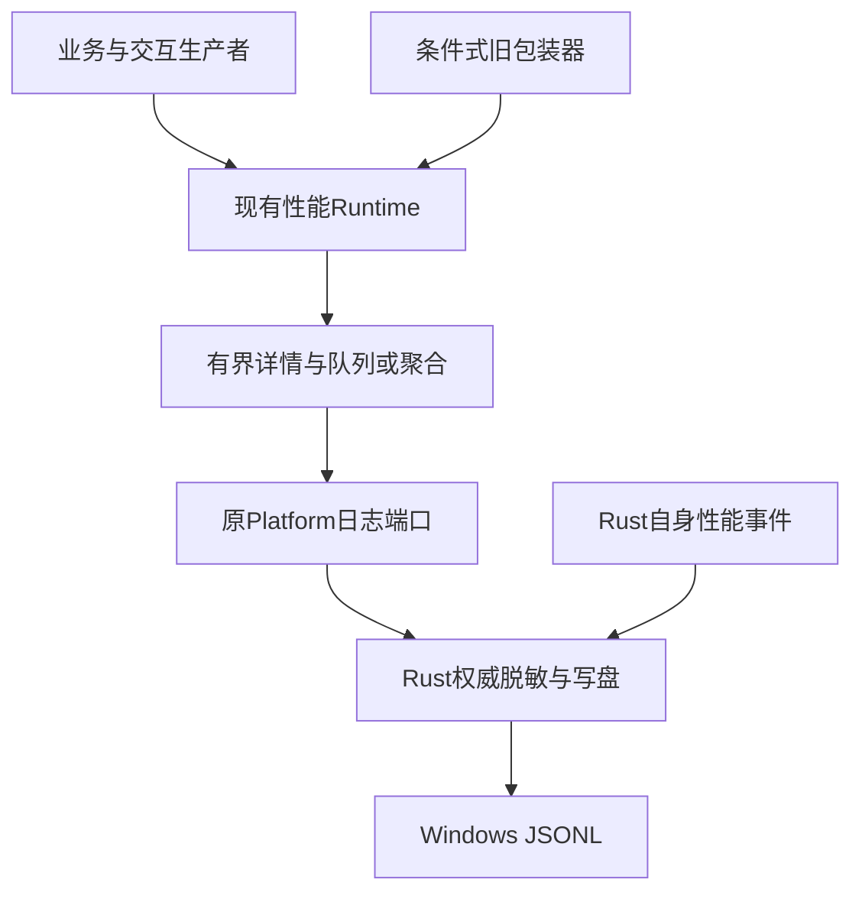

# R15-01 遥测事件目录

状态：**正式验收收尾**（bc561a5 / CI38357762013，七组Windows及全部步骤成功）；15.2正在同分支实施。唯一分支`agent/r15-stage`，文档收尾基线`62ad8f37df472e0a9cc970358e99bc4203296f70`，生产代码基线`16d7b395ae7728731f1cbe4b39d5b11e4a5d377e`。R14及18在[CI38347726196](https://github.com/uniquenesssta/mdr/actions/runs/38347726196)七组与全部步骤成功，全仓2213、前端1206、33Controller/View、29Writer、34Image、58Data、11＋67浏览器、Rust281和四格式实际文件占用失败/原件保留/恢复通过；五归档摘要及实际PNG已核对。[18正式验收](R14-18-DETAILS.md#正式验收2026-10-13)。

## 本项范围

按15.1“事件目录、不更改用户可观察行为”，新增测试域[event-catalogue.json](../tests/fixtures/stage-15-telemetry/event-catalogue.json)、24项[契约测试](../tests/stage-15-event-catalogue.test.mjs)与独立[VM基线宿主](../tests/support/telemetry-runtime-host.mjs)。没有改生产源码、Rust、模型算法、依赖、日志格式、E2E桥或已有场景。目录不是生产白名单/第二个Recorder，不提前创建未使用的Service/入口；Recorder公共职责从15.2实际迁移。

目录覆盖43个生产/转发/详情提供/原生边界，112个具体前端operation、31个条件式旧函数包装器、20个当前invoke命令（日志自身record:false排除于roundtrip）、8个Rust生产事件、224个当前已声明详情字段及2个跟踪历史JSONL的元数据。每个来源保存Git blob SHA；动态document.${operation}-error、native.${command}与任意public record输入另列，不伪装成封闭枚举。展开后的具体事件与动态家族存在描述关系，数量不能相加为实际发射次数。

| 当前前端category | 具体operation条目 |
|---|---:|
| app.lifecycle | 5 |
| document.error | 3 |
| document.lifecycle | 2 |
| document.model | 1 |
| document.operation | 1 |
| editor.hybrid | 29 |
| editor.input | 1 |
| export.operation | 5 |
| link.preview | 5 |
| native.dialog | 3 |
| native.roundtrip | 19 |
| render.pipeline | 10 |
| runtime.error | 2 |
| runtime.event-timing | 6 |
| runtime.performance | 3 |
| sidebar.file-tree | 2 |
| storage.recovery | 1 |
| sync.selection | 2 |
| ui.interaction | 7 |
| ui.layout | 5 |

Rust类别另为app.lifecycle/native.command，source=rust且无sessionId；前端8字段为timestampMs/sessionId/source/category/operation/durationMs/status/details，Rust7字段少sessionId。category/status默认ui.operation/ok，diagnostic默认runtime.diagnostic；duration数值强制转换、非负、3位小数，无效null；现行接口仍接受自定义category/status，15.1不暗中增加校验。

## 稳定字段与候选噪声

详情字段逐项标记为稳定标量候选或敏感/高基数复核：207项稳定候选、17项复核候选。数量/尺寸/耗时/版本/布尔与有限枚举原则上可保留；ID、key、文件名、rootPath、host、reason/message/error、target/userAgent等不能因旧日志存在而自动准入。类型、枚举、基数/上下文仍须15.2/15.3逐项决策；开放或spread对象保持显式“未穷尽”，不得宣称所有未知详情已验证安全。

两份历史JSONL仅记录路径、SHA-256、条目数和详情key名称，不复制正文/路径值/秘密，不回写原文件；历史字段不等于当前发射入口。清理历史日志由15.13承担。31个包装器按window函数实际存在才安装，许多名字已退休；配置总量不是安装/事件数。

本轮还登记现状差异：hybrid.mermaid-render-result的envelope.status默认ok，而details.status是rendered/cached/failed；layout.system-fullscreen-error当前省略status，默认ok。这些是15.2的输入/语义审阅对象，15.1保留现状和对照，不悄悄修正或删除。

## 当前所有权与明确接收

Mermaid Chart已展示实际链路。没有新增库或陌生第三方API，本项使用项目现有Runtime和Node内置VM；无需新增Context7查询。

| 当前事实 | 接收任务 | 本项不宣称 |
|---|---|---|
| safeDetails只约束深度8/节点512/对象64key/数组20/字符串300，仍保留输入敏感字符串到Rust边界 |15.3；继承R12真实payload→Rust→JSONL硬回归|前端已最小化/脱敏|
| queue1000正常入队淘汰，但失败整批unshift可超出；250条flush失败后50ms续调，部分append无确认边界 |15.4/15.7 A04|重试有界、exactly-once或A04修复|
| 现有global/listener/interval/observer没有统一destroy |15.5/15.6/15.8|新生命周期已实施|
| E2E opt-in/production/stale dist沿用当前已验收链 |15.9～15.12|已迁新QueryAPI或放宽开关|

当前release禁日志已有真实回归，不能推断debug部分失败安全；已确认主应用不可用/不可控磁盘增长须按任务书止损。本项不新增忙循环、不运行无界重试，也不改变debug/release策略。

## 验证与测试退出计划

24项新增契约：2项目录/来源静态覆盖，真实旧Runtime的信封、默认/开放输入、6种duration、同步与异步成功/错误身份、聚合分组/样本统计、诊断去重/期限、正常队列上限、250批次尾部、失败一次50ms续调、嵌套有界详情、标量快照、实际包装器安装量和DEV=false无自动全局/计时器。测试捕获实际Runtime处理结果，不手造替代生产record算法；失败重试只观察一次，夹具dispose清掉测试timer。

VM宿主遵循既有R12性能payload测试机制，只在独立测试上下文暴露实际Runtime方法，没有application/window复活接口、真实写盘或第二生产状态。15.2新公开Recorder出现后替换此测试宿主，15.11完成旧源码文本依赖退出；历史目录仍作为对照保存，迁移测试须提供行为映射，不以旧字符串挡住合理迁移。

Windows workflow接入agent/r15-stage并加入24项专项；七组所有原步骤、完整Node、原67页面、Rust281、原生实际Writer/导入/脱敏、依赖、安全和体积门禁保持。未增加产品browser场景，因为本项不改变产品。源码审查只证明目录覆盖，不替代运行结果。

本地仅执行目录/文档/配置静态检查、语法与测试注册，不运行功能VM回归、构建、browser或Rust；功能结果交新head Windows CI。01待验收，整体R15与A04尚未完成。

R15-01 首轮 Windows CI 38352488733（b56c3e7）未通过：15 项旧工作流契约仍精确要求单一 R14 分支。新增 24 项遥测契约与实际 Windows WebView、安全、依赖和原生 opener 作业通过；递归 Node、前端累计及 Rust 前置接口检查被旧分支断言阻断，不能据此验收。修复仅将 15 处断言更新为工作流实际的 R14/R15 精确双分支，并在路由契约同时确认 R15 遥测步骤保留。原累计门禁、场景及产品代码不变，等待新 head Windows 全量验证。

本次修复静态验证：15 项失败工作流断言逐项通过，历史路由 3 项通过，架构、旧运行时、生成文件、README 记录四项门禁通过；未在本地运行产品功能、构建、浏览器或 Rust。

## 正式验收（2026-10-13）

R15-01正式收尾：bc561a5 / CI38357762013七组Windows及全部步骤通过，遥测基线24/24、全仓2237/2237、前端1230/1230、浏览器11+67、Rust281及真实Windows WebView/安全链通过。首轮b56c3e7失败记录保留。 三份当前提交产物摘要已校验，最终汇总accepted=true。仅01收尾，A04仍未修复；R14既有验收保持，02继续原R15分支。
