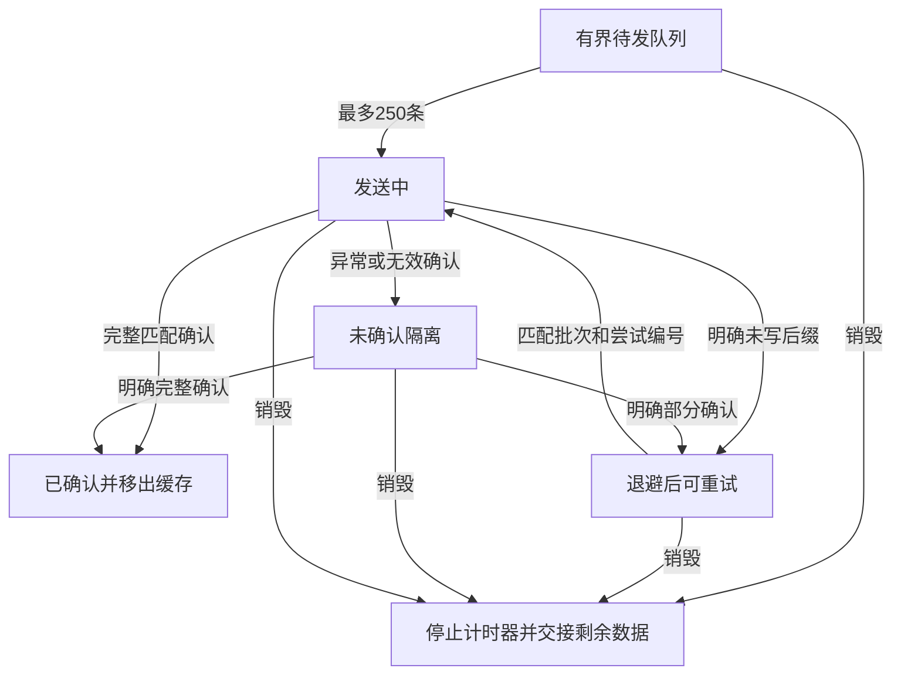

# R15-04 Aggregation Buffer

唯一分支 `agent/r15-stage`；基线c77ffbb / CI38408451605。R15-03修复后七组Windows作业及全部步骤通过，脱敏33+真实payload3、Recorder22、目录24、全仓2293、前端1286、浏览器11+67、Rust281；三份归档摘要与最终同提交accepted=true核验，正式收尾。首轮格式失败记录保留。04已实施，等待新提交Windows验收，15.5未开始。

## 唯一所有者与接口

公共入口提供 `createAggregationBuffer`，`aggregation-buffer.js` 唯一拥有窗口聚合、queue、in-flight/ready/unconfirmed批次、完成确认缓存、溢出计数、退避与重试Timer。旧Runtime这些状态/算法删除，record/diagnostic/measure、snapshot、定时drain与flush全部接入该公共能力；不直接读写文件或平台全局。

依赖显式注入clock、Recorder.createEntry、writeBatch、schedule/cancel、batchPrefix及安全onError。数据经公共Recorder/Redaction再验证、分离引用，nullable duration保持null。operation/category/status与1500ms窗口组成键；最多200个聚合组，旧窗口及组超限先转入有界队列。

每组记录samples、合法duration样本的在线avg及min/max、非负period；避免无效时长拉低平均值、全无效时长误报0与大有限值相加溢出。仅合法duration参与平均；全无效输出null，负duration归0。独立批次最多250条，排队+在途+未确认总条目最多1000。确认前缀立即从批次内存移除；所有容量溢出记录丢弃entry数和聚合samples数，不把它包装为“全部数据已保存”。

## A04 前端处置与确认语义

| 返回或动作 | 前端行为 |
| --- | --- |
| batchId+attempt匹配，acceptedCount为当前offset到总数的整数 | 确认并移除该前缀，只保留明确未写后缀 |
| 明确acceptedCount未推进或部分推进 | 同一batchId、递增attempt、正确offset重试；最小250ms，指数退避上限30s |
| 拒绝/无效/越界/过时响应 | 未确认隔离，整批不插回queue、不盲目重放 |
| 后续明确匹配receipt | 可推进隔离批次；重复完整确认无副作用，旧prefix不能倒退进度 |
| 已隔离旧批次后的新输入 | 在同一容量/退避限制内发送新批次，不重放旧批次 |
| disable/destroy | 取消Buffer自身Timer；晚到结果不再安排写入或重试 |
| destroy | drain聚合并返回只读pending交接，带batchId/attempt/offset/dispatched/state；不清空未送/未确认数据、不等待外部I/O |

当前生产LogsPort仍是原有数组→path接口。Runtime只把其正常返回映射为完整客户端receipt；异常一律视为不确定，无法证明磁盘实际已写多少。已隔离数据保留在受限pending中，必须由15.7原生日志协议查询/恢复，不能宣称已经落盘、已经完成真实Windows部分append修复或A04已关闭。该前端batch/attempt/offset/累计acceptedCount契约交15.7共用；真实响应丢失、占用/拒绝/写满与读回证明仍待该项。

Buffer独立销毁测试覆盖其重试Timer和晚到dispatch。Runtime旧DOM/Observer、周期interval和应用pagehide完整生命周期统一归15.8；本项不把纯Buffer交接等同于整个应用持久化关闭。save/close无需等待日志重试；队列满时只计数和有界保留，不阻塞业务结果。Runtime snapshot增加overflow entry/sample、unconfirmed和acknowledged数值指标，交接中的原始用户正文/路径保持已脱敏。

## 验证与旧契约映射

新增41项公共契约：依赖/容量策略、分组/窗口、合法均值、负/无效/大时长、组与队列溢出、250批次、并发flush、部分/零确认退避、未知失败隔离与新输入恢复、明确迟到/重复/旧确认、6种坏receipt、保护在途容量、disable、销毁Timer/dispatch/在途、异常getter、实际Runtime统计与重入销毁。

保留R15-01原24项。原整批unshift/50ms契约改为明确验证legacy失败保留50条未确认且不盲目重放，A04仍未关闭。旧平台客户端职责断言改查单一Buffer所有者、Runtime诊断与无unshift/有backoff；LogsPort自记录禁用、真实frontend→desktop→Rust JSONL、R15-02全部22、R15-03全部33及3个payload覆盖保留。Runtime测试VM注入真实公共Recorder+Buffer，源加载仅服务尚未迁移的诊断/DOM装配，最终在15.11移除。

生产模块556、风险来源90，冻结模型、Rust生产/测试、依赖、原生接口、输出数据格式、全部体积门槛与67实际页面场景保持；七组Windows全部旧步骤保留，增加telemetry-buffer.log。历史目录43来源SHA保持，通过旧Git基线验证已迁移Runtime，新的公共职责契约和当前风险SHA约束实际迁移代码。

本地仅静态、语法、来源、文档和测试注册；产品功能、构建、浏览器及Rust仅在Windows CI执行。04尚未验收。

## 实际批次状态图

已使用Mermaid Chart插件渲染下图；只表达当前Buffer实际状态与动作，不表示15.7已实现原生日志确认。

补充Recorder先销毁时的交接契约：Buffer不能物化的聚合组保留在只读pendingAggregates，带原batchPrefix，既不静默清空，也不伪装成已发送；正常生命周期先销毁Buffer再销毁Recorder。

最后静态复核通过：四项架构/生成/文档门禁，8个变更JS/MJS语法，160个相对文档链接，90个风险来源blob SHA；冻结审计根记录与历史前缀、原七组CI及全部旧步骤、受保护生产/依赖/预算保持。仅注册检查确认41+33+22+24=120项，未执行其中功能回调；静态公共职责/目录/平台来源契约通过。新增41项功能契约及累计产品验收等待本次精确提交Windows CI。
