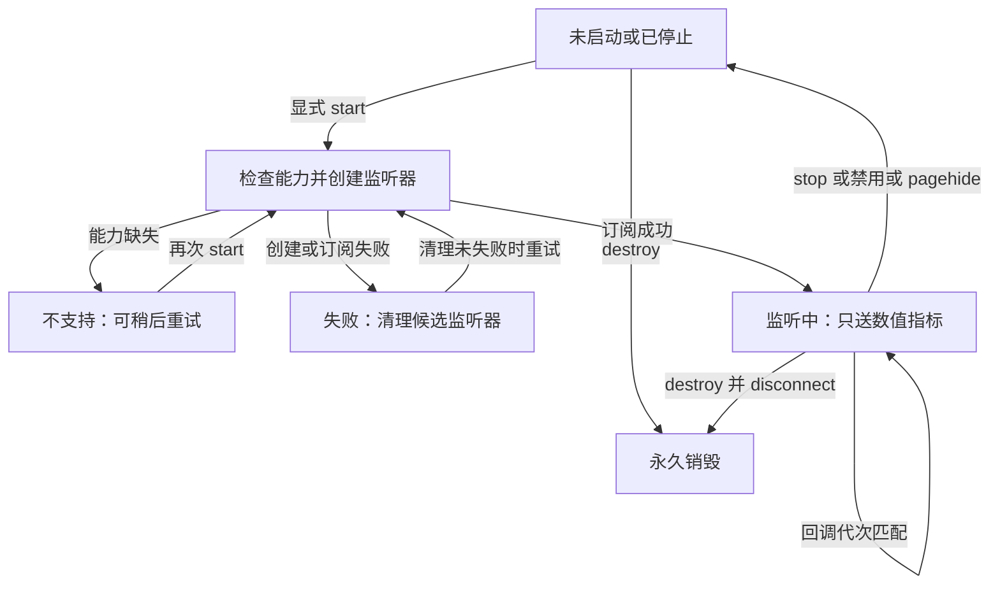

# R15-05 Long Task Observer

唯一分支 `agent/r15-stage`；基线96fa3af / CI38421131243。R15-04七组Windows及全部步骤通过，Buffer41、脱敏33+真实payload3、Recorder22、目录24、递归Node2334、前端1327、浏览器11+67、Rust281；三份下载归档摘要与同提交最终accepted=true核验，正式收尾。05已实施，等待本次精确提交Windows验收，15.6未开始。

## 单一监听所有者

公共入口导出 `createLongTaskObserver`；`long-task-observer.js` 唯一拥有长任务Observer引用、订阅代次、启动历史和安全状态。构造不解析宿主、不订阅、不读DOM、不创建计时器或写日志；`getObserver`、`record`、`isEnabled`、`onError`全部注入，公开start/stop/destroy及只读getState。旧Runtime的长任务构造、回调和observe算法删除，事件/导航Observer暂留原处，等待15.8统一Runtime生命周期。

start先检查启用条件与宿主能力；没有API或supportedEntryTypes明确不含longtask时返回unsupported，不抛错或创建监听器。缺少supportedEntryTypes的旧宿主尝试observe，真实拒绝转为failed，并disconnect候选对象。重复start不创建第二份Observer；构造/observe的重入stop/destroy不能把状态恢复成running。

只有首次成功启动使用`{type:'longtask',buffered:true}`。停止后重新启动使用buffered=false，避免重放之前的历史缓冲；停用期间事件明确不补录。stop先失效代次、脱离引用再disconnect，destroy永久关闭。迟到的旧回调和同批后续记录在stop/destroy后都被拒绝；disconnect重入start也不能生成第二份监听器。

宿主disconnect异常会记录安全phase、标记cleanupFailed并阻止再次创建，避免与可能仍存活的旧监听器重叠。此异常路径只能证明逻辑回调已隔离，不能声称宿主物理资源成功释放。正常stop/destroy则有明确一次disconnect及零附着引用契约。

## 实际Runtime接入与隐私

Runtime注入浏览器内建PerformanceObserver、公共Recorder.record和DEV+LogsPort启用条件。configure启用启动，禁用停止；DEV pagehide停止长任务监听，pageshow按当时启用状态恢复。release即使启用LogsPort也不创建Observer，不安装性能全局；工厂本身可由显式调用独立测试。整个应用的DOM/事件/导航Observer、周期Timer和最终destroy仍归15.8，本项不声称完整Runtime清理完成。

长任务输出保持`runtime.long-task / runtime.performance`，只读取entryType、合法非负有限duration/startTime，startTime按三位小数记录。name、attribution、路径、正文等宿主字段不读取、不保存；字段getter/list读取/记录端口异常仅输出固定phase，不输出异常文本。后续正常条目仍可处理，不阻塞应用业务。数据经实际Recorder脱敏及Buffer确认链路；A04原生账本、真实Windows部分append与幂等确认仍待15.7，未关闭。

## 验证与保留边界

新增39项契约：公共职责、四项依赖校验、无导入/构造副作用、重复start、缺API/不支持/旧宿主/后续恢复、启用门禁、数值schema、八种非法entry、异常getter/list/record/diagnostic、stop与destroy、能力/构造/observe失败及恢复、disconnect失败、重入构造/observe/disconnect/entry/record、实际Recorder→Buffer确认以及实际DEV Runtime的pagehide/pageshow、禁用/销毁和release不创建Observer。

Runtime夹具注入真实公共Recorder、Redaction、Buffer及LongTaskObserver，通过原Runtime装配函数与浏览器端口验证接入；未使用替代遥测payload。Rust实际frontend→desktop→JSONL生产者只更新公共工厂注入，原三条payload场景和原生命令/数据格式保持。夹具源加载仅服务未迁移的Runtime DOM装配，仍在15.11统一移除；本项不将源字符串静态边界检查冒充可观察生命周期证明。

R15-01目录24、Recorder22、Redaction33+payload3、Buffer41及全部累计场景保留，七组Windows全部旧步骤保留，只新增telemetry-long-task.log步骤。生产清单557模块、风险来源91，历史根验收与失败记录不改写。模型、Rust生产/测试、依赖、所有体积门槛、原生接口、E2E runner与67实际页面场景保持。本地仅静态/语法/来源/文档/测试注册；功能、构建、浏览器和Rust仅由Windows CI验证，05尚未验收。

## 插件与接口依据

仓库AGENTS.md要求系统API变更调用Context7。本项确认浏览器内建API无新增包版本，使用`/mdn/content`查询PerformanceObserver的supportedEntryTypes、longtask单类型buffered订阅与disconnect；没有向插件传递源码或用户内容。依据：[supportedEntryTypes](https://developer.mozilla.org/en-US/docs/Web/API/PerformanceObserver/supportedEntryTypes_static)、[observe](https://developer.mozilla.org/en-US/docs/Web/API/PerformanceObserver/observe)、[disconnect](https://developer.mozilla.org/en-US/docs/Web/API/PerformanceObserver/disconnect)。重启不补录是本项目明确策略，未声称浏览器自带跨Observer去重。

Mermaid Chart已渲染实际状态图；失败清理无法确认时禁止重启，状态图中的重试条件保留该边界。

最后静态复核通过：四项架构/生成/文档门禁、6个JS/MJS语法、162个相对文档链接、91个风险来源blob SHA；历史审计根记录及历史前缀、557模块旧行、七组CI及全部旧步骤、受保护文件保持。注册39+41+33+22+24=159项，未执行功能回调；四项公共职责边界及两项原目录来源/元数据静态契约通过。05功能与累计产品验收等待本次精确提交Windows CI。
