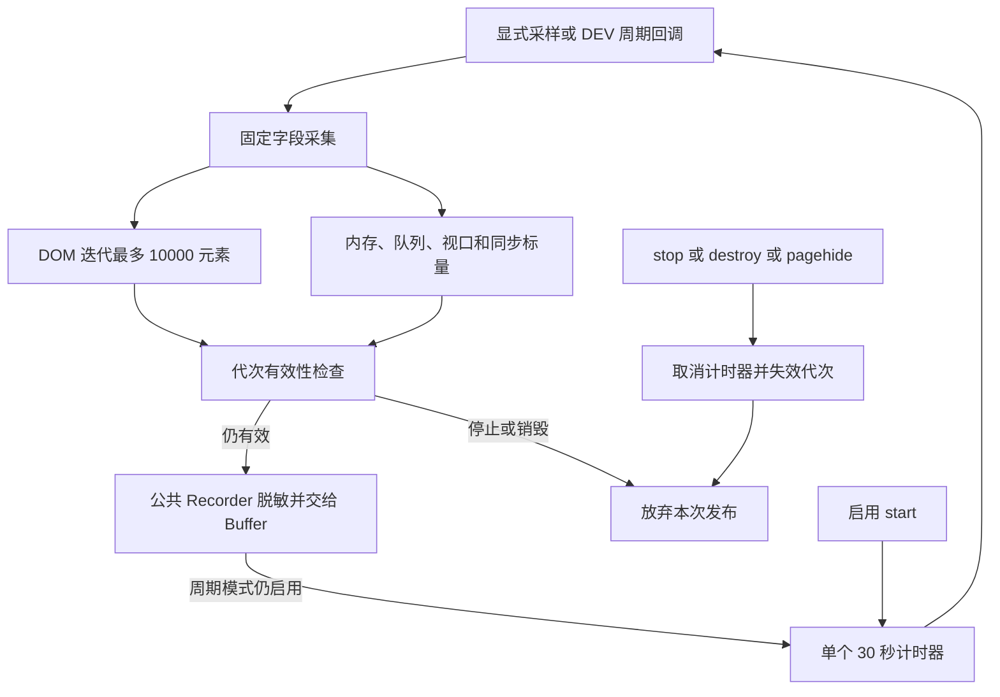

# R15-06 Runtime Snapshot

唯一分支 `agent/r15-stage`；基线a9be96d / CI38425603742。R15-05七组Windows及全部步骤通过，长任务39、Buffer41、脱敏33+真实payload3、Recorder22、目录24、递归Node2373、前端1366、浏览器11+67、Rust281；三份下载归档摘要与同提交最终accepted=true核验，正式收尾。06已实施，等待本次精确提交Windows验收，15.7未开始。

## 有界快照所有者

公共入口导出 `createRuntimeSnapshotRecorder`，`runtime-snapshot-recorder.js` 唯一拥有快照字段投影、DOM计数策略、采样重入/代次屏障和周期计时器。旧Runtime的完整快照算法及不可销毁的snapshot interval删除；Runtime只注入Document、内存、视口、Buffer.getStats、同步统计、Recorder.record和计时器能力。构造不采样、不安装Timer、不读取浏览器全局、不写文件。

DOM使用Document作为TreeWalker根，只遍历SHOW_ELEMENT。默认最多推进10000个元素，可降低预算，禁止扩大上限；不创建`querySelectorAll('*')`的全量NodeList，不读取节点正文、属性或路径，不持有节点/列表/来源状态。未到上限则输出精确元素数；达到上限输出预算值及domNodesCapped=true，表示达到采集预算，不能据此推断恰好上限还是更多。能力缺失/遍历异常输出domNodes=null；不退回无界查询。

每次各读取一次DOM、memory、Buffer、viewport、runtime五个同步来源；固定22个字段，包含原21字段及新增domNodesCapped。内存只取usedJSHeapSize/totalJSHeapSize，未知或非法输出null，合法0保留0。queue、aggregate、overflow entry/sample、unconfirmed、acknowledged及同步计数只保留非负有限数，取整数并封顶MAX_SAFE_INTEGER；非法输入归0，字符串/对象不强制转数值。scrollSourceSide仅editor/preview或空串。额外属性、函数、循环对象、正文和路径不枚举、不复制。

字段/来源异常输出固定安全phase及对应未知/默认数值，其余来源继续采集；不输出异常文本。sample在端口读取或属性getter重入stop/destroy后不再读取其他来源或发布；重复同步sample拒绝重入。记录仍由实际公共Recorder进行脱敏并经Buffer确认，不新建第二套事件/隐私/日志所有者。

## 计时器与Runtime接入

提供显式sample/start/stop/destroy及只读getState。start只安装一个30秒计时器，第一次采样在首个周期；后续完成采样再安排一个继任Timer。可配置周期范围1000～300000ms，不形成短间隔忙循环。重复start不增加Timer；stop失效代次并取消Timer，destroy永久阻止手动、周期或再次启动。stop之后仍允许显式手动sample，保持原Runtime测试/诊断调用语义；destroy后全部采样关闭。

调度失败可在显式后续start恢复；取消失败标记cleanupFailed并阻止创建可能重叠的Timer。迟到旧Timer在逻辑上失效且不再采集或安排继任；宿主拒绝取消时不能宣称其物理计时器已成功清理。计时器端口使用异步单次调度语义，来源端口为同步只读采集。

实际Runtime的DEV+LogsPort门禁控制自动start/stop；pagehide停止、pageshow按启用状态恢复。release不自动采样或创建Timer，不安装性能全局；已有显式手动快照调用保持。长任务既有39契约保持，事件/导航Observer、DOM监听及另外两个旧周期drain/flush继续归15.8统一Lifecycle，本项不声称完整应用已销毁。A04原生确认、幂等和真实部分append仍待15.7，未关闭。

## 验证与保留边界

新增51项公共契约：十项依赖、六项预算/周期限制、无构造副作用、固定schema与五来源各读一次、无限/空/低于/等于/高于预算DOM、缺能力与遍历错误、五来源异常、合法零/非法/巨大计数、隐私循环对象、属性getter、单Timer/重复启动、禁用/停止/重启/销毁/迟到回调、调度/取消/记录失败及重入、实际Recorder→Buffer receipt，以及实际DEV Runtime的10000预算/同步统计/pagehide/pageshow/禁用/销毁和release手动兼容。

Runtime夹具注入真实公共Recorder、Redaction、Buffer、LongTaskObserver和RuntimeSnapshotRecorder，浏览器DOM/Timer端口只服务确定性的能力/预算/生命周期故障验证。该夹具不证明真实Windows浏览器每次DOM扫描耗时；原11+67浏览器与真实Windows WebView链继续保留作为累计产品验证。VM源码加载仅服务剩余Runtime装配，15.11统一移除。Rust实际frontend→desktop→JSONL生产者只增加公共工厂注入，原三条payload、原生命令与输出格式保持。

公共入口/风险清单增加一个模块：生产558模块、风险来源92，旧行及冻结属性保留；七组Windows及原步骤保持，只新增telemetry-snapshot.log步骤。R15-01目录24、Recorder22、Redaction33+payload3、Buffer41、长任务39和全部累计场景保留。冻结模型、Rust生产/测试、依赖、体积门槛、原生接口、E2E runner和67实际页面场景不变。本地仅静态/语法/来源/文档/测试注册；功能、构建、浏览器与Rust待本次精确提交Windows CI，06尚未验收。

## 插件与接口依据

按AGENTS.md调用Context7查询浏览器内建TreeWalker；无新增依赖包。`/mdn/content`确认Document根、SHOW_ELEMENT=0x1及nextNode推进/返回null语义，预算由本项目显式控制。依据：[createTreeWalker](https://developer.mozilla.org/en-US/docs/Web/API/Document/createTreeWalker)、[nextNode](https://developer.mozilla.org/en-US/docs/Web/API/TreeWalker/nextNode)。原performance.memory只作为可选来源；不可用不假造堆大小。

Mermaid Chart已渲染实际采集与周期状态图：

最后静态复核通过：四项架构/生成/文档门禁、6个JS/MJS语法、164个相对文档链接、92个风险来源blob SHA；历史审计根记录与历史前缀、558模块旧行、七组CI及全部旧步骤、受保护文件和README历史保持。注册51+39+41+33+22+24=210项，未执行功能回调；五项公共职责边界及两项原目录来源/元数据静态契约通过。06功能与累计产品验收等待本次精确提交Windows CI。
