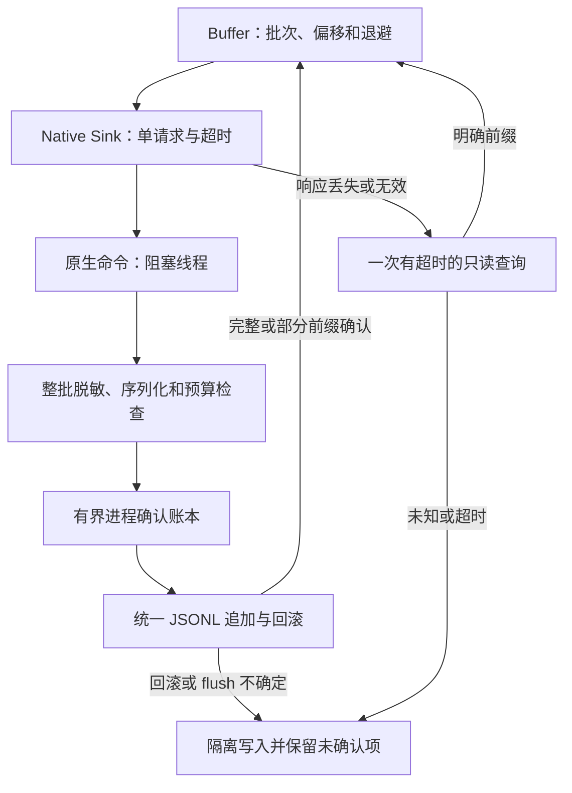

# R15-07 Native Sink 与 A04 批次确认

2026-10-15：按“收尾06开始07”，从已验收c871637在唯一agent/r15-stage实施。06：[CI38588143325](https://github.com/uniquenesssta/mdr/actions/runs/38588143325)七组及全部步骤成功，正式记录见[06验收](R15-06-DETAILS.md#正式验收2026-10-15)。07已实施，等待本次精确提交Windows累计验证，A04尚未验收关闭，15.8未开始。原R12交接和R15-01历史目录不重写为已修复。

## 所有权与兼容

公共createNativeLogSink拥有单个请求、等待Timer和一次确认查询；AggregationBuffer继续唯一拥有队列、聚合、累计确认、批次序号、退避与重试。Runtime仅按需装配并经原LogsPort调用；不再把路径字符串当作确认。Desktop adapter沿用writePerformance方法，传入批次元数据时调用新增write_performance_log_batch，record:false防止日志递归。无元数据仍调用write_performance_logs，原签名、字符串结果和错误传递保持。

原生command仅委派，debug通过Tauri阻塞线程执行文件操作；batch.rs拥有进程内确认账本；writer.rs是新旧入口共用的唯一JSONL追加、回滚和写入锁边界。保留原19命令及R13取消命令，新确认命令插入取消命令之前，累计21条；原19名称、次序及签名保持。生产模块558→560，风险来源93→99，新增两个实际所有者，无依赖变更。

## 协议和失败边界

请求携带batchId、offset、attempt、total；entries仅含当前未确认后缀。响应只包含批次身份、attempt、acceptedCount、state与固定安全reason，没有正文、异常原文或日志路径。Sink验证身份、attempt、累计范围及complete必须等于total，返回最小只读确认给Buffer。未知、missing、expired、rejected、uncertain和旧路径字符串均不能授权重放。

|情形|实际行为|
|---|---|
|序列化/单项/整批超限|先对整批递归脱敏和序列化；全部成功才解析路径或打开文件。零条落盘；旧入口也统一预校验。serde_json::Value本身已是JSON值，序列化错误仍显式返回，大小错误通过真实超限输入覆盖。|
|文件打开失败/目录失败|明确零进展或保持已知offset，固定partial原因，Buffer有限退避。Windows独占句柄真实阻止打开，解除后恢复并读回。|
|write_all写完部分帧后失败|以write权限而非append-only句柄打开文件，在统一写入锁内seek到末尾；记录帧前长度，set_len回滚不完整帧；只确认之前完整行，后续仅写未确认后缀。故障夹具在真实临时File写入半行再返回模拟磁盘写满错误。|
|回滚失败或flush失败|结果标为uncertain并隔离该进程后续新旧写入；前端保留未确认项，禁止盲目整批重放。|
|已写成功但响应丢失/格式无效|Sink只发一次空entries的query，查询账本不打开文件；无法取得明确确认则保留隔离。|
|重复请求/过时attempt/变化payload|账本校对完整已脱敏帧、total、offset和attempt；完整重复不追加，错位/变化拒绝。完成账本可驱逐，但会话高水位不驱逐，旧序号不能因此重放。|

这是一份**进程内**确认账本，不是持久事务日志。不保证断电或进程崩溃后的恰好一次，不自动重放销毁交接或跨进程批次。flush不等同sync_all持久化；未声称OS磁盘操作可取消，也未将模拟写满当成真实耗尽系统磁盘。原生后台record_backend仍沿用既有同步路径；本项不承诺所有后台调用的硬实时延迟。

## 有界策略与业务隔离

Buffer原上限1000待送条目、200聚合组、250条批次与250ms～30s退避保持。明确partial最多八次尝试，随后保留为unconfirmed；未知结果直接保留。每个Sink只允许一个请求，每次等待默认2000ms、允许250～5000ms，失败最多一次同样有超时的确认查询，没有另一个重试队列。destroy拒绝等待、取消Timer并消费晚到结果；取消失败可观察并阻止新等待。完整Runtime DOM/Observer/周期flush销毁仍归15.8。

原生每项64KiB、每批1MiB；新协议250条，旧兼容入口仍最多500条。确认账本最多200批、32会话、4MiB帧字节，只驱逐明确完成批次；未完成项占满则拒绝新批次。单进程JSONL文件最多16MiB，统一writer在每帧前复核，触顶返回partial，不再增长。没有后台无限轮转；多进程/多次启动日志保留政策仍需后续产品策略。

测量API同步返回业务结果或按原Promise结算，不等待日志flush；失败不会替换保存/关闭的结果与错误。新原生命令的文件I/O不在主事件线程内执行。新增挂起日志的保存/关闭测量契约，保留既有真实四格式安全输出、关闭与WebView链。此处承诺前端日志不成为业务等待条件，不外推为任意阻塞磁盘下所有原生后台操作均有硬截止时间。

release command与writer均在校验、路径、账本和文件访问前返回禁用。Runtime DEV自动装配入口在生产关闭，显式测试手动测量兼容；生产没有性能全局/自动记录/Timer。将Recorder、Buffer、LongTask和Sink统一按需装配，以便Vite静态DEV裁剪；实际体积仍由原700000字节Windows构建门槛决定，不以源码推断代替验收。

## 验证与历史契约迁移

新增31项公共Sink契约涵盖依赖/时间预算、完整/部分确认、错批/错attempt/越界/不确定确认、一次查询、双超时与晚到Promise、并发、销毁、取消失败、禁用、元数据、真实Desktop载荷、八次重试及挂起日志不延迟业务结果。新增17项原生契约覆盖真实临时文件完整读回、部分帧回滚、零写入恢复、丢响应查询、回滚/flush不确定隔离、错位/变化/过时拒绝、账本驱逐与200项/32会话/4MiB上限、1MiB预校验、16MiB文件预算、实际前端→Desktop→新command→JSONL读回以及真实Windows独占失败/恢复。

原R12-15九项全部保留；其中partial场景从“第二项校验失败留下第一行”迁移为“整批预校验零落盘，随后合法写入恢复”。R12源顺序契约显式拆为prepare和统一append两个边界，仍检查脱敏→序列化→大小→写入→flush，并新增回滚。R12命令注册保留原19与取消命令，精确检查新增第21条。R15-01的43份历史blob原值不变，已迁移writer/command/main/client来源按原baseline核对；当前源码同时纳入风险清单和新行为契约。没有删场景、skip或放宽预算。

保留目录24、Recorder22、脱敏33+实际payload3、原Buffer41、长任务39、Snapshot52、浏览器11+67及七组Windows全部旧步骤。仅新增Sink与原生批次确认两个专项步骤；Rust格式步骤通过mod遍历覆盖新文件，原release harness增加新协议禁用检查。冻结模型、依赖锁、E2E runner、旧67实际页面场景及全部阈值保持。

本地只做静态门禁、JS语法、来源/文档/清单和测试注册，不执行功能、构建、浏览器或Rust产品验证。Rustfmt作为源码编辑工具应用现有max_width=120格式；Windows仍独立检查。07通过与否由推送后同提交Windows结果决定。

## 插件依据

按AGENTS.md使用Context7：项目Rust1.88与Tauri2锁定依赖未改，查询std::io::Write::write_all、File::set_len、flush与持久化区别。Tauri仓库查询未命中，后续官方文档库确认async命令与async_runtime，spawn_blocking采用本仓现有local_file命令同型调用；不能把宽泛查询作为特定版本API已验证的证据，实际编译交Windows。参考[std Write](https://doc.rust-lang.org/std/io/trait.Write.html)、[File set_len](https://doc.rust-lang.org/std/fs/struct.File.html#method.set_len)、[Tauri async runtime](https://docs.rs/tauri/2/tauri/async_runtime/fn.spawn_blocking.html)。Mermaid Chart已渲染实际批次确认、回滚、查询与隔离链路，未绘制持久事务或完整生命周期。

Windows句柄复核补充：微软[SetEndOfFile](https://learn.microsoft.com/en-us/windows/win32/api/fileapi/nf-fileapi-setendoffile)要求GENERIC_WRITE，因此统一writer使用write(true)+truncate(false)并在锁内逐帧seek末尾，故障夹具也使用实际可截断File；不能仅凭append-only句柄假定set_len能回滚。此接口权限依据已查询，实际读回与恢复仍交Windows。

提交前静态记录：四项架构/旧Runtime/生成文件/文档门禁通过；15个JS/MJS语法、99风险来源blob、560生产模块、相对文档链接、原生旧测试名称及受保护范围核对通过。保留七组Windows与全部旧步骤，仅增加上述两个专项；原211项遥测名称/顺序保持，新增31项，总注册242项，未执行功能回调；新增17项Rust仅源码注册。六项迁移来源/命令/写入边界和九项当前来源/公共职责静态契约通过。功能、构建、浏览器、Rust和体积仍待本次Windows，以上记录不代表07验收。

## 首轮失败与修复（2026-10-15）

R15-07首轮306e5bb / CI38675939373未通过：前端1449/1449、全仓2456/2456、Sink31、浏览器11+67及真实WebView通过，main685.76kB通过原预算；原生17项中15通过、2项字节预算夹具失败，Rust二进制284/286，最终汇总正确拒绝。原夹具近60000字节字段名被64字节键名规则移除，导致脱敏后未达到上限。修正仅用合法分组构造精确字节数据，增强脱敏后尺寸、帧字节和账本保留断言；17项名称、产品、工作流、全部门槛保持。待同分支修复提交Windows复验，06验收保留，A04未关闭。

[首轮Windows CI38675939373](https://github.com/uniquenesssta/mdr/actions/runs/38675939373)精确提交306e5bb61ff2ee50de0db87406f63eb623ad69ed，七组逐步核对：五组完整成功；Rust专项与完整Rust执行在同两项夹具失败，最终汇总因Rust failure拒绝。Rust格式、Clippy、check、原九项writer、六项lifecycle、release禁用及实际前端JSONL读回均通过。未把未运行的后续Rust集成测试计入成功；Rust二进制记录为284通过、2失败，共286。

失败测试为batch_serialized_byte_budget_is_checked_before_the_first_file_write与batch_uncompleted_receipts_cannot_exceed_the_ledger_memory_budget。旧sized将长度全放在一个近60000字节键名，redact_nested明确移除键长超过64的字段，输入变为空对象。结果18份也未触达1MiB，四份账本也未占4MiB；这是新增夹具错误，不是提升预算的理由。修复采用既有通过Windows的R12合法五组×60字段结构：每键56个ASCII字节、每组60字段≤64、路径值≤160字节、总节点306≤512。分配填充值后同时核对原始与实际生产redact_value后的序列化长度，均精确为请求字节。

60000字节条目加换行60001字节，17条1020017字节小于1MiB，18条1080018大于1MiB；65537字节条目必须超过原64KiB门槛。四个未完成账本4080068字节未满4MiB，第五个将超过；拒绝第五个后明确查询原四批均partial/acceptedCount=0且无文件写入。原17项名称及失败边界保持，增加前置真实性和保留断言。此次修复不改产品、工作流、依赖、模型、99来源覆盖范围、560模块及任何预算，不增加/移除场景。

四份失败归档已下载并逐一核对SHA256，最终同提交accepted=false：

|归档|ID|SHA256|
|---|---|---|
|Rust|11945704128|892159d8c2192b7b62387d484e8f71087d34f27867115772baaf5d49d3e73a9c|
|最终汇总|11945639249|f12b9058f24de4a523d0bee90bd6e014ee260854d355b3aca8bef33d3f6ddd1c|
|前端|11945934322|ccc3883282ad51998b3dd320d162025784d3ff2189ee5886e20d53b2bfdf5901|
|全仓|11946462096|58c2cb29047851a8d8779d11faf413afbae8ea378398bda111d75e78edf5e6b2|

本地只应用现有Rust源码格式，并执行来源/差异/文档静态核对；不运行Rust/Node功能或构建/浏览器。原生功能、格式与累计验收继续交同一分支的新精确提交Windows。此次为单个测试文件修复，无新框架或系统API，未重复调用Context7或变更Mermaid架构；前述插件依据保留。

修复提交前静态复核：README记录门禁、99来源当前blob与历史R12指纹契约通过；17项原生名称及顺序保持，170个相对文档链接、git diff --check通过。变化严格限于一个Rust测试文件与六份状态/失败记录文档，生产、模型、依赖、工作流、560模块清单与全部预算字节保持。没有将本地静态结果当成Windows功能通过。

## 正式验收（2026-10-15）

R15-07正式收尾：8c7e232 / CI38688232262七组Windows及全部步骤通过，Sink31、原生批次17、全仓2456/2456、前端1449/1449、浏览器11+67、Rust298；四份下载归档摘要与同提交accepted=true已核验。首轮两项夹具失败及修复保留；A04进程内批次确认/有界重试风险在本范围关闭，历史R12交接不回写。

精确提交8c7e23272fb0753a8ae79963e0c38f1a872019b1，[Windows CI38688232262](https://github.com/uniquenesssta/mdr/actions/runs/38688232262)。七组及全部步骤逐项成功，原生17/17、Rust二进制286/286及集成5+1+6，共298。前端1449、递归全仓2456（352文件/16目录）、Sink31、目录24、Recorder22、脱敏33+实际payload3、Buffer41、长任务39、Snapshot52、浏览器11+67及真实WebView八场景通过；main685.76kB通过原700000字节门槛。

|归档|ID|核验SHA256|
|---|---|---|
|最终汇总|11952050161|674bfbfa41a1f8dd4ed16e2f4c3a80766298bc6a813ce032984e984f7d40a55d|
|前端|11951032065|626191a53bbc3a26195edab558de49c2e12cc477bdd5b15f0a365a954939e78a|
|全仓|11950684737|82255644a8930b15e499b3d78f2f3f85419e01dc6da2bc29fd91a870c218552a|
|Rust|11951370386|186c2e8fc2c7d8a695cc767f6b1a156696d3580134114ff3916f2a06ea596989|

已下载并验证四份归档；最终accepted=true与精确提交一致。A04当前进程内部分append/响应丢失/有界队列与重试/日志文件增长处置具备Windows证据，按当前范围关闭；不扩大为崩溃/断电持久恰好一次，也不扩大为任意阻塞磁盘下旧原生后台同步日志的硬实时保证。原始R12 handoff与R15-01 frozen目录的fixed=false仍是历史语义，以currentStageAcceptance及subsequentAcceptance记录后续处置。完整生命周期由15.8接续。
