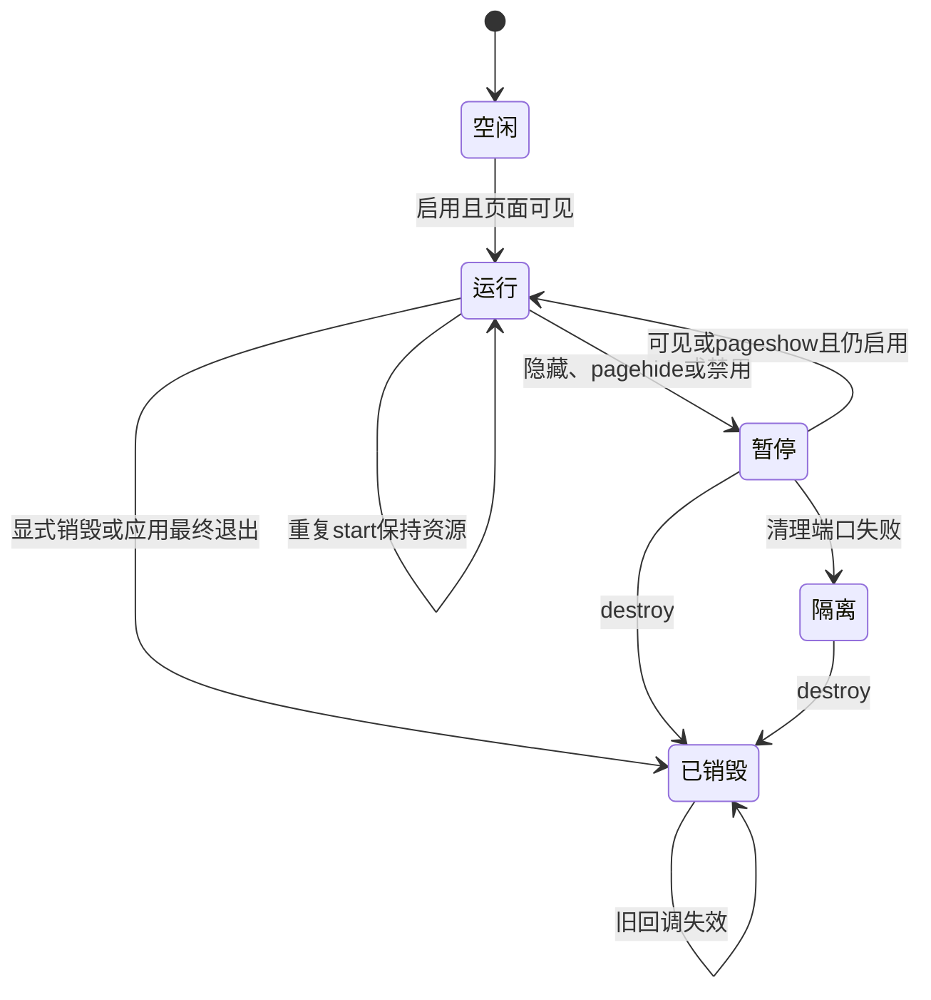

# R15-08 Telemetry Lifecycle

当前已正式验收：d8520d2 / CI38726360552；以下实施记录保留原待验收状态，最终结果见[正式验收](#正式验收2026-10-15)。

2026-10-15：按“收尾07开始08”，在唯一agent/r15-stage从已验收8c7e232继续。07：[CI38688232262](https://github.com/uniquenesssta/mdr/actions/runs/38688232262)七组及全部步骤通过，31项Sink、17项原生、全仓2456、前端1449、Rust298和浏览器11+67成功，四份下载归档摘要与accepted=true核对；[07正式验收](R15-07-DETAILS.md#正式验收2026-10-15)保留两项夹具失败/修复。A04在当前进程内确认/有界重试范围关闭，历史R12的fixed=false继续表示原交接。08已实施，等待自己的精确提交Windows验收，15.9未开始。

## 单一所有者

公共createTelemetryLifecycle拥有自动采集的状态、代次和资源：构造不访问端口；mount至多注册pagehide/pageshow/visibilitychange三个控制监听；start统一安装采集监听与Event Timing/Navigation观察器，启动原LongTask和Snapshot所有者，安排1500ms聚合drain及2000ms flush。重复mount/start保持单份资源，不再使用两个无法清理的setInterval。

Runtime保留既有事件语义、诊断抑制、字段读取与DEV装配；所有DOM监听通过scope.listen、帧通过scope.frame、滚动burst与ready flush通过scope.timeout注册。原观察器回调与DOM匿名回调不再脱离所有者。Public Recorder、Redaction、Buffer、Sink、LongTask与Snapshot各自职责不复制；Lifecycle通过start/stop/destroy端口协调它们。

每次成功周期调用结束后仅安排一个继任Timer；flush Promise未结束时不再叠加同周期工作。Buffer本身仍唯一拥有批次、退避与确认；Lifecycle不建第二个日志队列或第二套重试。Snapshot继续拥有自己的单个30秒Timer，LongTask继续拥有自己的观察器代次。正常启用后为三个周期Timer；有互动、retry或native receipt等待时可能有额外受限的一次性工作，不声称总Timer永远等于三。

## 暂停、恢复、销毁

|入口|真实行为|
|---|---|
|重复start|当前running直接返回；不重复观察器、监听或周期Timer。|
|禁用/stop|代次先失效，独立逆序释放资源、Timeout和RAF，再暂停Buffer退避、LongTask和Snapshot；不丢弃未确认队列。控制监听保留以支持恢复。|
|页面hidden/pagehide|尝试一次drain/flush，不等待它结束，随后stop；重复隐藏不会重复触发同一代次。|
|visible/pageshow|仅在LogsPort仍启用且页面可见时启动新代次；pagehide后在pageshow前不会因手动start或visibility信号提前恢复。|
|最终退出|实际main.js原pagehide功能清理的finally中，DEV且非BFCache退出调用destroyPerformanceTelemetry；初始化失败也调用。BFCache pagehide只暂停遥测，恢复由pageshow协调，不宣称其他应用feature已经具备BFCache重建能力。|
|显式destroy|停掉全部自动资源、控制监听和旧包装器；独立销毁Sink/Snapshot/LongTask/Buffer/Recorder，关闭原生等待，清诊断状态与注入引用；永久禁止再次自动启动。|

旧函数包装器逐项保存original/wrapped及清理函数；暂停恢复原函数，恢复时仅按已请求的instrumentation重新安装。若应用随后替换了同名函数，清理不覆盖新函数。性能全局仅在DEV发布，销毁只恢复自己占用的槽位与之前的属性描述符，不覆盖外部新全局。原全局record/measure/flush等诊断入口保持，并增加start/stop/destroy/getState以显式管理生命周期；它不是新的产品UI或E2E内部对象出口。

销毁先获得Buffer只读有界交接，再销毁Recorder。若Buffer取消端口抛错，仍尝试snapshot保存pending；其他所有者继续清理。结果包含安全handoff和cleanupFailed，重复destroy返回同一结果。它是进程内交接数据，不是崩溃持久化或跨进程重放协议。最终关闭不await日志；最终退出后的未确认日志可能尚未写盘，不虚报已保存。

## 有界资源与异常

活动代次最多256项监听/观察器/包装器清理函数、1000个一次性Timeout和64个RAF。周期配置1000～300000ms，原1500/2000默认值保持；调度端口必须异步一次性，拒绝同步回调造成递归忙循环。取消或完成均释放当前资源记录，旧代次/迟到Timer、RAF、DOM、Observer回调不会发布或安排继任。

注册前先持有清理权；如果addEventListener或observe内部重入stop/destroy，返回后再复核并移除可能迟到挂上的资源。isEnabled端口重入之后也再次校验代次。安装异常回滚已安装资源；可选观察器不支持时单独降级，observe失败断开候选。清理中的destroy请求在整轮stop清理完成后处理，避免中途发布虚假的完整销毁报告。

每个清理动作独立执行，失败不能阻断剩余资源；取消/移除/断开失败会标记cleanupFailed并阻止再次启动，迟到回调仍逻辑失效。无法取消的宿主句柄不声称已物理消失。错误只输出固定phase，不输出异常正文。暂停期间已经发出的单个原生请求仍可在07已有超时/一次查询边界内结束，destroy则拒绝并取消等待；不新增后台无限循环。

release不mount、不自动创建Lifecycle、Timer、观察器或性能全局；07的显式手动测量夹具语义保持，直到显式destroy。全局显式调用仍可用于诊断，自动回调由scope控制。生产DEV分支由Vite裁剪，实际包体仍接受原700000字节Windows预算，不以静态推断替代构建。

## 契约与累计门禁

新增49项公共契约：14个依赖、5个周期边界；冷构造、重复start/mount、异步周期不重叠、隐藏/恢复/禁用、capture匹配、迟到帧和Timeout、销毁交接与晚到Promise、安装/观察器/调度/取消/清理失败、同步调度拒绝、资源上限，以及enable/listen/observe/mount/清理过程重入。五项实际Runtime契约覆盖三个周期Timer、interaction RAF/scroll burst暂停、包装器恢复及外部替换、原生等待销毁与pending交接、release手动兼容。

既有242项遥测及三条实际payload保持。R15-05的“禁用后单独销毁LongTask”原场景名称保留：LongTask仍不再复建；Event/Navigation现在随Lifecycle正常重建，所以将原总实例3断言明确迁移为LongTask总1及全部实例5；重复configure的原3实例断言不变。所有观察器接收迟到回调仍拒绝。测试域host增加真实公共Lifecycle注入、DOM remove与RAF端口，不再依赖手工清空集合冒充产品销毁；新契约在host兜底dispose前检查资源已归零。

生产560→561模块，新增一个实际Lifecycle；全部旧清单属性和风险路径保留，更新变化blob并保留之前指纹。七组Windows及全部旧步骤保持，只增加telemetry-lifecycle.log专项。原31 Sink、17原生、Snapshot52、LongTask39、Buffer41、Redaction33+payload3、Recorder22、目录24、浏览器11+67、Rust298及真实Windows WebView/原生输出继续累计。此次不改原生产品、依赖、模型、日志协议、预算和E2E runner；并未开始15.9查询API或15.11 runner重写。

本地只运行静态门禁、JS语法、来源/文档/注册和原名称顺序核对。Windows Node夹具验证实际公共所有者及Runtime装配，不证明真实浏览器事件调度耗时或所有BFCache行为；原11+67与真实Windows WebView仍累计保留。功能、构建、浏览器、Rust和体积全部由本次精确提交Windows决定，08未验收。

## 插件依据

按AGENTS.md使用Context7 `/mdn/content`查询EventTarget移除规则与pagehide/visibility/BFCache：remove必须保持相同回调和capture值；pagehide兼容BFCache，但不是保证送达或完成写盘的可靠事务边界。采用原监听值与代次屏障，未新增unload/beforeunload遥测处理或sendBeacon协议。现有浏览器标准API、Vite7与依赖锁保持，参考[removeEventListener](https://developer.mozilla.org/en-US/docs/Web/API/EventTarget/removeEventListener)、[pagehide](https://developer.mozilla.org/en-US/docs/Web/API/Window/pagehide_event)。Mermaid Chart已渲染真实状态图：

提交前静态记录：四项架构/旧Runtime/生成文件/文档门禁通过；9个JS/MJS语法、101当前来源blob、561模块及全部旧行属性、174个相对文档链接、git diff --check通过。43份事件目录原blob保持；本次src/main.js生命周期接线的冻结来源按原baseline核对，同时由当前来源清单和真实destroy接线静态契约约束。原242项遥测名称与顺序保持，新增49项，共291项注册且未运行功能回调；10项来源/公共职责静态契约通过。七组Windows和全部旧步骤保持，仅新增Lifecycle专项；原生、模型、依赖、E2E runner和预算未改。08尚未验收。

## 正式验收（2026-10-15）

R15-08正式收尾：d8520d2 / CI38726360552七组Windows及全部步骤通过，Lifecycle49、全仓2505/2505、前端1498/1498、浏览器11+67、Rust298；三份下载归档摘要与同提交accepted=true已核验。

精确提交d8520d20de61d628aed4d9d5a0077655d0478475，[Windows CI38726360552](https://github.com/uniquenesssta/mdr/actions/runs/38726360552)。七组作业及全部步骤成功。Lifecycle49/49、既有遥测242、前端1498/1498、递归全仓2505/2505（353文件/16目录）、浏览器11+67、Rust298及真实Windows WebView八场景保持通过，main685.77kB满足原700000字节门槛。

|归档|ID|核验SHA256|
|---|---|---|
|closeout|11967979468|af0adc5e771ae1112648c817f033a1066744622ca67a15541cec27a3caae4fe5|
|repository-tests|11967803237|bdf21b547407ed410b885cadbaf8e847e2e60bf285f3a3d220db20f9b5bf71a6|
|frontend|11967279529|2f28b4df3c3af0f04ce4d07271db4706d90ae503a62245d55ce02f894f49f25e|

三份归档均已下载并计算摘要；最终汇总accepted=true、commit与run一致。此处只将08及已覆盖的遥测生命周期正式收尾；历史R12根验收及A04原handoff字段保留，A04当前进程内范围已在15.7关闭。后续15.9负责E2E语义边界，15.10负责专门安装门禁，15.11负责runner完整迁移。
