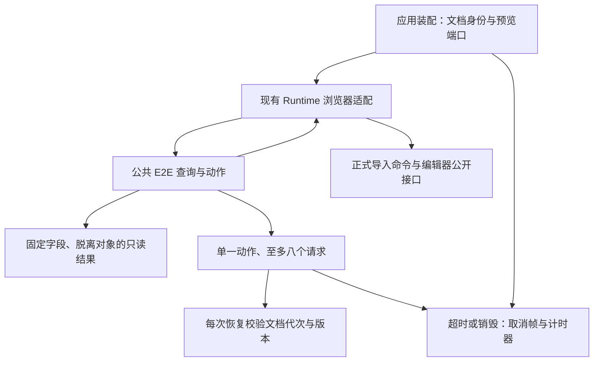

# R15-09 E2E Query API

2026-10-15：按“收尾08开始09”，在唯一agent/r15-stage从已验收d8520d2继续。08：[CI38726360552](https://github.com/uniquenesssta/mdr/actions/runs/38726360552)七组及全部步骤成功，Lifecycle49、全仓2505、前端1498、浏览器11+67、Rust298；三份下载归档摘要与同提交accepted=true核对，见[08正式验收](R15-08-DETAILS.md#正式验收2026-10-15)。09已实施，59项契约与新增1项真实页面待自己的精确提交Windows验收，未提前完成15.10安装门禁或15.11 runner迁移。

## 职责与正式链路

公共入口src/features/e2e/index.js只导出createE2EQueryAPI；e2e-query-api.js唯一拥有语义查询、动作编排、DTO投影、请求身份和等待清理。工厂不访问DOM、全局、模型、平台、文件系统或其他feature内部模块，全部通过17个显式能力端口接入。

src/runtime/e2e-bridge.js保留现有opt-in安装与浏览器适配：DOM只在此读取；适配器调用编辑器已有公开方法、正式importTextContent命令以及main注入的文档身份/预览指标提供者。旧waitForIdle、loadMarkdown、revealPosition/revealText编排已删除，无第二套权威算法。main只从DocumentModel.getState提取documentId/generation/version，从Preview Controller公开getVirtualStats取得指标，不将model/controller/platform作为API属性发布。

已有九个方法名称及调用方式保留；新查询返回语义数据，调用者不必拿内部对象：

|入口|返回与行为|
|---|---|
|loadMarkdown(source, options)|走正式导入；采用导入完成时返回的身份，再做焦点、视觉选项、布局、定位，返回只读snapshot。支持编辑器CRLF/CR转LF，focusText按实际编辑器文本定位。|
|setLayout(mode, options)|规范化为both/hybrid/edit/preview，返回布局字符串。|
|setVisualEditing(options)|code/table有值才修改；返回undefined。|
|revealPosition / revealText|走公开focus/selection/scroll/find能力，返回裁剪后的数字位置；preserveSelection不写焦点或选区。|
|waitForIdle(options)|在静默窗口内确认组件/活动元素/预览指标稳定且无待处理渲染；成功true，超时/过时/销毁/失败false。|
|snapshot()|固定字段的就绪、布局、文档身份/代次/版本、长度、选区、呈现统计、组件和活动元素描述。|
|getComponentStates()|仅组件状态标量投影，不返回任意details或feature引用。|
|getPreviewStats()|固定预览数值、active和scope；缺少虚拟预览时返回明确零值，不发布controller或priorityChapter对象。|
|getEditorValue()|显式测试读取完整文本字符串。|
|clearStorage()|显式清空浏览器存储并返回true；有活动请求时拒绝。|
|destroy() / getState()|关闭此查询所有者；诊断仅返回销毁/清理状态及请求、等待数量。|

全部嵌套对象/数组由新对象构造后冻结；不直接冻结feature对象，不拷贝任意属性，不读未知getter。组件状态及DOM描述各最多1000项并有truncated标志；13项呈现统计与固定预览指标数值经过有限非负检查。DOM只留下tag/id/class/type等字符串描述，任意details、方法、DOM节点、编辑器/模型/控制器对象不跨边界。完整正文和选中文本保持精确字符串，属于显式E2E读取，不进入遥测；它们不宣称受1000项组件上限约束。

## 请求与清理边界

最多八个异步请求、同时一个修改动作。输入选项在开始时复制；每个请求拥有一份250～30000ms总超时（默认6000ms），静默窗口20～1000ms（默认80ms），最多2000轮采样。每次RAF/计时器恢复及副作用前后检查documentId/generation/version；换文档、换代次或编辑版本变化均终止旧请求，禁止迟到选择、滚动、布局和结果发布。

导入会有意替换身份，因此先注册等待，再调用正式导入端口，收到loaded=true和完成时身份后校验当前身份及实际文本才采用新身份。导入失败、内容不匹配、过时、超时或销毁均不进入后续动作。已经提交给正式Import Controller的导入本身不能由本API撤销；超时/销毁只关闭查询请求及后续处理。适配器在await命令返回后先检查请求有效性，无效时不再读取文档提供者。

每个等待句柄使用null哨兵，0是有效句柄。独立deadline不依赖RAF，所以背景页RAF暂停仍能由计时器终止等待。浏览器事件循环与OS调度不保证硬实时截止；不将“配置超时”描述为阻塞线程下的硬实时保证。结束或destroy取消所持RAF、短Timer和deadline；旧回调/Promise只消耗迟到完成，不安排继任。底层cancel失败标记cleanupFailed并阻止再次工作，不假称物理资源已消失。错误仅输出固定安全消息，不携带正文、搜索词或底层异常正文。

main的原destroyDocumentFeatures入口首先销毁适配器，初始化失败也清理。Runtime清空自己持有的提供者，销毁公共所有者；仅在全局槽位仍是自己时恢复原属性描述符或删除，不覆盖外部替换。宿主锁住属性导致恢复失败时返回false，查询所有者已终止且应用其他feature继续清理，不声称全局槽位已移除。公共API.destroy本身关闭查询实例；适配器全局槽位与装配引用在Runtime/application销毁时释放。本轮保留原标记或e2e=1条件、无参数installer及既有全局名；完整安装门禁的独立公共所有者、默认生产实测仍归15.10，不创建尚未使用的features/e2e/e2e-bridge.js。

## 契约与累计验证

新增59项：17个依赖、冷构造/方法面、所有嵌套DTO脱离/冻结、未知getter/异常脱敏、指标规范化、组件上限、完整文本、查询中身份变化、静默/待处理渲染/预览、暂停RAF超时、布局/视觉选项、定位/保留选区/查找、三种过时身份、并发与八请求上限、导入身份/定位/换行/拒绝/不匹配、未完成导入超时/销毁与晚到拒绝、0句柄、销毁后拒绝、端口/选项/调度/取消失败、同步调度/重入、存储竞争，以及三个实际Runtime安装/清理/原门禁契约。

真实built-app新增1项，在原导出characterization（其中包括最终pagehide）前，通过公共API验证冻结数据、无details/对象泄漏、查询不改身份/选区、正式布局/定位动作、静默及请求归零，并归档r15-09-query-api.json。原67项页面名称、顺序、断言及11项浏览器契约全部保留；runner只添加这一项实际集成验证，15.11将再完整清理其旧内部访问与fallback。本轮保留旧browser-e2e-contract五项名称及顺序；第一项原“bridge包含loadMarkdown”源码断言迁移为适配器调用公共入口且新所有者定义loadMarkdown，其余断言保持。适配器仍承接公开编辑器与正式导入边界；这是已迁移职责的位置变更，不删除原方法契约。

七组Windows及全部旧步骤保持，只增加e2e-query-api.log专项；既有291项遥测、原生17、Rust298、模型、锁文件、原生产品和原700000字节预算保持。生产561→563模块；新入口/语义所有者纳入清单，全部旧模块属性（仅适配器责任说明更新）保留。当前风险来源纳入新API、适配器与契约，旧来源指纹保存在迁移历史，43份事件目录冻结blob不变。A04在15.7已关闭的当前进程内范围保持，历史R12根验收与handoff不回写。

本地只做静态架构/旧Runtime/生成文件/文档门禁、语法、来源指纹、契约注册及旧名称顺序检查；没有执行功能回调、构建、浏览器或Rust。功能、体积和真实Windows应用结果均由本次精确提交CI决定，09尚未验收。

## 插件依据

按AGENTS.md使用Context7 `/mdn/content`查询requestAnimationFrame后台暂停、取消句柄与setTimeout语义；依据[requestAnimationFrame](https://developer.mozilla.org/en-US/docs/Web/API/Window/requestAnimationFrame)、[cancelAnimationFrame](https://developer.mozilla.org/en-US/docs/Web/API/Window/cancelAnimationFrame)、[setTimeout](https://developer.mozilla.org/en-US/docs/Web/API/Window/setTimeout)，采用独立deadline、null句柄哨兵与迟到回调屏障，不新增依赖。Mermaid Chart已渲染当前真实链路，未绘制15.10/15.11未实施功能：

提交前静态记录：四项门禁通过；7个JS/MJS语法、105当前来源blob、563模块及旧清单属性、163个相对文档链接、三份08归档摘要、git diff --check通过。仅执行7项来源/公共边界静态契约；新59项注册而未执行功能回调，原291项遥测与5项浏览器静态契约名称和顺序保留。旧runner除新增单项页面块之外字节一致，七组Windows与全部旧步骤逐项保持，仅新增E2E专项。09仍待精确提交Windows验收。

## 首轮失败与修复（2026-10-20）

基准为唯一 `agent/r15-stage` / `5731941ff576bf8dc07b3d080c0179c7219d204f`，工作区初始干净。首轮 [CI38730937138](https://github.com/uniquenesssta/mdr/actions/runs/38730937138) 未通过：09契约58/59、前端1556/1557；实际页面66/68，HTML/Word的450024 UTF-16字符准备均在layout步骤失败。构建main692.86kB通过700000字节预算，Rust、真实Windows WebView、原生链接和依赖作业通过，最终汇总正确拒绝。前端归档11970925747已下载，SHA256 `d67a0d30abbde55c690caab1e0919beda862f4e497e3fa9a0c45c8855df22d07` 与API和上传日志一致。

两个确认的问题及修复：

- 默认焦点的旧正则跳过Mermaid开启行后，会把其关闭行当作普通代码开启行，得到21而非27。现在按行配对跳过整个Mermaid围栏，只在其外识别代码块；兼容缩进、长围栏、波浪线及未关闭的Mermaid，不匹配正文中的行内反引号。原失败断言保持。
- 准备过程已处于both布局，仍重复调用正式setLayoutMode，重新应用编辑器呈现与布局。08通过归档11967279529（下载SHA256 `2f28b4df3c3af0f04ce4d07271db4706d90ae503a62245d55ce02f894f49f25e`）同一大文档layout耗时22605ms；旧API忽略waitForIdle的false结果，而09的独立总deadline正确拒绝超时（本轮HTML16721ms/Word14418ms）。修复由公共语义所有者统一比较当前布局，相同布局不重发命令，仍执行原idle/身份/待处理工作检查；不同布局继续正式命令。loadMarkdown与setLayout使用同一路径。没有延长超时、忽略失败、减小夹具或删除真实文件断言。此修复消除已证实的重复重建，最终大文档是否在预算内通过仍待本次Windows实际运行。

新增8项独立契约：重复布局的稳定等待与原deadline失败、5种围栏边界、导入后的同布局幂等。09共67项契约。原59项名称/断言与原67个页面保留；第68项公开API真实场景增加透传计数，确认重复布局不重发正式命令，原实际布局切换、读回、身份和清理断言继续执行。无需新增依赖或改变模块/生命周期边界，原架构图仍适用。

本地只执行语法、四项静态门禁、来源SHA和差异/场景保留复核；没有执行功能回调、构建、浏览器或Rust，不将静态证据替代Windows结果。09尚未验收，08验收与历史R12记录保持；15.10未开始。推送后启动精确提交累计Windows CI，确认启动即结束本轮，不轮询。

修复提交前复核：首次架构门禁因新检出缺少现有依赖失败；按锁文件执行既有deps:prepare后重跑通过。四项静态门禁、3份JS/MJS语法、105个当前来源SHA、原59项注册名称/顺序、原68页面场景及单项新增页面块以外runner字节、CI/依赖/原生/大文档夹具不变、历史验收和git diff --check均已核对。共67项契约只登记而未执行功能回调；构建/实际页面/Rust仍待Windows。
