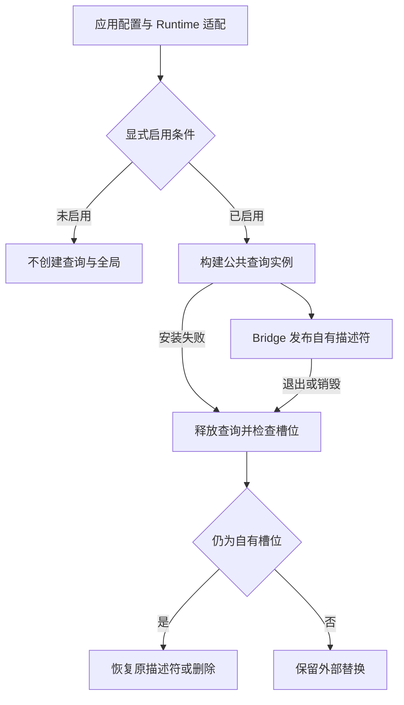

# R15-10 显式 E2E 安装门禁

2026-10-23，用户要求“收尾09开始10”。09已核验 `4fa93d2` / [CI39361525737](https://github.com/uniquenesssta/mdr/actions/runs/39361525737)七组Windows及全部步骤成功，Query67、全仓2572、前端1565、浏览器11+68、Rust298及三份归档摘要、accepted=true，详见[09正式验收](R15-09-DETAILS.md#正式验收2026-10-23)。本项继续唯一 `agent/r15-stage`，起始检出干净；10已实施、待自己的精确提交Windows验收，15.11 Runner整体迁移与15.12 stale-dist重写未开始。

## 职责与真实接线

`src/features/e2e/e2e-bridge.js` 的 `createE2EBridge` 唯一拥有安装判定、查询工厂、安装中状态、私有API引用、原描述符、失败回滚及终止状态。构造只验证四个注入能力，不读取宿主或安装全局。公共入口同时导出既有 `createE2EQueryAPI` 和新Bridge，语义查询、模型/版本屏障和有界等待继续由09原所有者负责。

`src/runtime/e2e-bridge.js` 保留浏览器环境/属性描述符、DOM与正式命令能力适配，以及main已经使用的configure/install/destroy名称。原Runtime中的门禁算法、providers、installed和previousDescriptor迁出，不保留第二套安装权威。main的文档身份/预览提供者、app-ready安装、初始化失败与pagehide销毁继续接通现有入口，无需改变UI或业务模块。

| 入口 | 行为 |
| --- | --- |
| isEnabled | 精确URLSearchParams首值e2e=1或testFlag严格等于布尔true；解析失败关闭 |
| configure | 未启用不保留查询工厂；启用后保存工厂，尚不创建QueryAPI；安装中/已安装/终止时拒绝重新配置 |
| install | 再查门禁，构造一次公共QueryAPI并发布不可写、不可枚举、可配置的测试槽位；重复安装不增加实例 |
| destroy | 丢弃配置、终止查询；槽位仍属于自身才恢复原描述符或删除；外部替换保留；重复销毁幂等 |
| getState | 冻结的配置/安装中/已安装/终止/清理失败标量，不公开Query、provider、DOM或宿主对象 |

默认构建未移除E2E代码，保证的是不创建QueryAPI、不发布测试全局；DEV模式不构成启用条件。浏览器标记仅读取自身数据描述符，不执行标记getter，不从原型链继承标记；字符串true与数字1不启用。显式e2e=1仍可在false标记下启用，保留已有OR语义。URL片段不是查询；重复参数保持URLSearchParams.get首值语义。

## 所有权、回滚与边界

安装前通过描述符检查，避免执行外部槽位getter。已有真值、访问器、不可配置或继承的槽位不覆盖；已有可配置的假值数据描述符可临时替换，销毁时精确恢复。工厂返回后再次复核槽位，保护同步重入产生的外部替换。

工厂异常、发布异常或静默未发布均拒绝安装；如果宿主先写槽位后抛错，销毁查询并撤销自己的部分写入。构造/读取/发布期间重入destroy，会拦截或清理晚到发布。查询destroy最多调用一次；即使它抛错仍尝试恢复槽位。删除返回false、恢复静默失败或宿主锁定槽位，均返回false并记录cleanupFailed，不声称已清除物理属性；该查询已终止，应用其他feature仍继续清理。错误使用固定文案，不泄漏宿主异常内容。

显式测试开关不是身份认证或安全沙箱；本项不新增后台监听或自动监测URL变化。API自身destroy只终止查询，宿主槽位与配置由Bridge/runtime/application销毁负责。应用销毁后Runtime可为下一次独立初始化创建新Bridge，原Bridge与旧查询保持终止。

## 验证与保留范围

新增41项独立契约：公共边界/冷构造、四依赖、14种门禁、异常环境、缺配置、禁用后释放工厂、重复安装与终止、描述符恢复、外部/访问器/锁定槽位、外部替换、工厂/发布失败、静默失败、重入销毁、晚到发布、底层清理失败、恢复复核及实际Runtime禁用配置释放。旧09的67项契约及291项遥测保持。

新增6项真实构建页面，由 `tests/e2e/lib/e2e-installation.mjs` 承担；每项使用独立浏览器profile，验证默认、错误query、false标记、字符串标记、精确query和布尔标记。启用场景实际导入文档、切换布局、精确读取文本，并经应用pagehide验证查询终止和全局删除。归档 `r15-10-installation.json`，失败仍使浏览器最终退出失败。原68项页面与11项交互契约保留，实际页面累计74；未进行15.11旧对象访问和fallback整体迁移。

实际Windows WebView原生验证另增加默认 `e2eOptIn=false`、`e2eGlobalPublished=false` 两断言，仍运行原真实Rust canary、CSP、导入与输出链。新增专项 `e2e-installation.log`，七组Windows及全部旧步骤保留。旧browser-e2e-contract门禁源码断言映射为Runtime调用公共Bridge、公共Bridge检查严格布尔与精确query；原测试名称与顺序不变。

生产模块563→564，仅增加唯一Bridge；110个当前风险来源指纹与迁移历史维护。冻结模型、原生产品、依赖/锁文件、700000/500000字节预算、保存和输出格式保持。历史R12验收快照与交接不重写；本项验收只由新提交Windows证据决定。

本地只执行静态门禁、语法、契约注册、生成的浏览器表达式解析、文档/指纹和差异核对，不执行产品功能回调、构建、浏览器或Rust。新41项及74个页面尚待Windows CI，不能据静态通过标记10验收。回退本项提交可恢复Runtime原安装所有权，不涉及用户数据迁移。

## 文档依据与现状图

Context7 `/mdn/content` 已核对 [getOwnPropertyDescriptor](https://developer.mozilla.org/en-US/docs/Web/JavaScript/Reference/Global_Objects/Object/getOwnPropertyDescriptor)、[defineProperty](https://developer.mozilla.org/en-US/docs/Web/JavaScript/Reference/Global_Objects/Object/defineProperty)、[Reflect.deleteProperty](https://developer.mozilla.org/en-US/docs/Web/JavaScript/Reference/Global_Objects/Reflect/deleteProperty)。描述符读取不调用属性getter；不可配置属性无法任意恢复；删除返回false也必须报告。使用标准接口，无第三方API或依赖版本变化。Mermaid Chart已渲染当前实现的安装/失败/销毁边界，尚未宣称Windows验收：

提交前静态复核：四项门禁、8份JS/MJS语法、110个来源SHA、186个相对文档链接及git diff --check通过。41项新契约只完成注册核对；旧67项Query、68项实际页面及导出夹具字节保持，七组CI及全部旧步骤逐项核对。5项现有browser-e2e源码契约通过，不冒充实际浏览器；构建、74项实际页面、新原生断言和Rust仍待Windows。

## 提交前接入远端规则更新

最终核对时，原分支新增20bc961（更新AGENTS）、0bc3975（删除本地ALL_AI_CODE）及81f60d3（删除本地AI_PROJECT_RULES）。已将本项接到 `81f60d3e49e0be221f0d39a697be209eb2f908f8`，保留三项远端修改；本项不再写AGENTS进度段，也不恢复已删除规则。按新AGENTS明确引用，远端skil/Code/0.0.1/AGENTS.md及其两份关联规则已完整读取。规则整理未改产品源码，09历史验收仍对应4fa93d2，10仍待新提交Windows验收。

## 首轮失败与修复（2026-10-23）

`fa0220f` / [CI39923924843](https://github.com/uniquenesssta/mdr/actions/runs/39923924843)未通过。Rust累计、RustSec和原生链接三组成功；前端依赖审计发现DOMPurify 3.4.16的critical公告及Vite 7.3.6的high公告。全仓Node、前端Node及WebView前置检查共同失败于同一旧断言：禁止源码出现任何`__markdownEditorE2E`，误伤10新增的`Object.hasOwn`默认缺席探测。最终汇总正确拒绝；WebView真实功能步骤未运行，不能将前置失败算作功能通过。

修复只更新既有DOMPurify至3.4.17、Vite最低补丁至7.3.7及对应锁定条目，不新增依赖或变更传递依赖。修复版本分别见[DOMPurify公告](https://github.com/advisories/GHSA-cg2g-xh64-v4q7)与[Vite公告](https://github.com/advisories/GHSA-rq7h-c2jc-7f22)。许可证保持MPL-2.0/Apache-2.0和MIT；npm登记解包体积分别为1,615,512和2,244,268字节，不代表生产包体增量，实际包体仍由既有500000/700000字节门禁验证。升级风险为净化和开发/构建行为变化，使用原安全、构建及真实页面回归覆盖；不采用跳过审计或修改安全策略的替代方式。

旧断言保留真实IPC、canary、CSP、源文件读取和原有安全链验证；允许`Object.hasOwn`观测属性存在性，并新增两项约束要求真实默认窗口的`e2eOptIn=false`与`e2eGlobalPublished=false`断言存在。继续禁止CDP、旧setDocumentContent、读取window/globalThis上的E2E API及替换原生invoke。生产probe和产品安装实现均未修改，74项页面及41项安装契约保持。

本地Windows已执行：`npm audit --audit-level=high`零漏洞；安全边界与安装门禁48/48通过；正式入口`npm exec --offline --call "node scripts/ci/run-repository-tests.mjs"`累计2613/2613，无跳过；四项架构门禁及浏览器交互契约11/11通过；`npm run build`通过，main约695.00kB，既有预算未修改。首次直接Node启动缺npm_execpath且沙箱拒绝浏览器清理，改用正式npm入口在本机复验后全部通过。74项实际页面首轮36通过、38失败，首次错误为CDP连接关闭；同机累计浏览器测试结束后单独复验，结果待补齐，不声称实际页面通过。Rust产品与锁文件未改，未在本地重复原生构建；新提交仍需完整七组Windows CI及原生WebView证据，15.10暂不标记验收，15.11未开始。

## CI复验结果（2026-10-23）

用户报告CI通过后，一次性核对修复提交`7233094ddb4e18c49d7fd897f00db0689622233e` / [CI39929368170](https://github.com/uniquenesssta/mdr/actions/runs/39929368170)：七组Windows作业及全部步骤均成功，无跳过。前端1606/1606、浏览器交互契约11/11、实际构建页面74/74通过；依赖审计、累计Node、Rust硬门禁、原生WebView安全/导入/输出链、原生链接及最终同提交证据汇总均通过。此次CI失败修复已获云端验证，不开始15.11。

本机实际页面单独复验仍为36/74，首个导出场景CDP关闭后其余场景无法继续；隔离首次失败场景也复现，WebSocket关闭码1006，根因尚未确定。并发资源争用的猜测未获证实；不得以CI的74/74覆盖或标记本机页面通过。保留此项待诊断，未将本次CI核对扩展为新的阶段正式验收或后续任务实施。

本次仅文档更新，不变更已验证实现或触发重复CI；遵循用户要求，推送后停止轮询，等待用户报告或明确要求查看结果。
