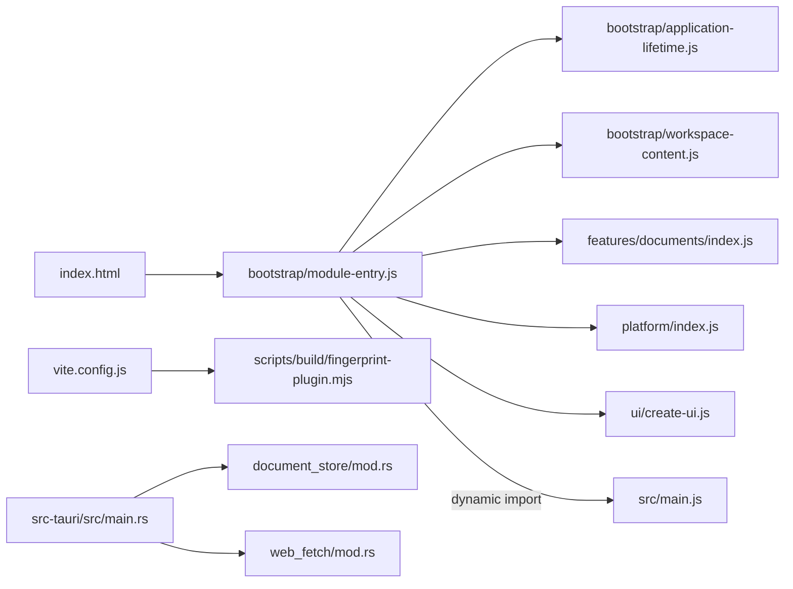

# R16-12 Import/Dependency Audit

2026-10-25，用户确认“11已通过 可以开始12”。11实现16c6c20 / CI40129983868七组Windows及全部步骤通过，同提交accepted=true、267风险指纹和两份下载归档摘要核验，正式收尾提交09071c022e0f47964b2be68cfb50c94fb101bd55。本任务沿用codex/r16-stage，仅实施16.12；16.13未开始。用户AGENTS.md既有修改保持且不提交。

## 当前依赖图与结论

完整机器可核对图见[audit/r16-12-dependency-graph.json](audit/r16-12-dependency-graph.json)。实际发现的532个生产文件全部作为节点，包含孤立模块，合计588节点、1187条带类型的边；ESM、CSS和Rust文件声明分别检查循环，当前循环和架构问题均0。未发现需要修改产品代码的跨功能内部依赖。

| 节点/边界 | 数量与说明 |
| --- | --- |
| 生产源 | 415 JS、52 CSS、64 Rust、1 HTML，共532。 |
| 仓库内补充输入 | 2构建脚本、17条件原生测试输入、1资源。 |
| 依赖边界 | 16 npm包、12 Cargo声明、4 Node内置模块、1 Rust标准库、1声明并锁定的字体glob。 |
| 配置 | package.json、Cargo.toml；package-lock及Cargo.lock参与输入摘要。 |
| JS关系 | 525 import、288 re-export、3 dynamic-import、1模块相对URL、1字体glob。 |
| 其他关系 | 51 CSS import、1 HTML资源、62 Rust模块、16显式路径模块、2 include、209命名空间引用、28包声明。 |

下图只摘录完整图中真实存在的入口边；完整节点、来源位置、边类型、查询参数和输入摘要以JSON为准，不把依赖注入的调用伪造成import边。

## 单一检查职责与边界

scripts/architecture/dependency-graph.mjs同时负责图事实和准入问题；现有checkDependencyBoundaries直接委托它，移除原正则式JS依赖检查及仅被它使用的路径解析函数。删除清单中的保守文本引用扫描仍服务删除证据，不作为第二套架构准入实现。四项原架构门禁及职责方向保持。

JS使用现有锁定开发工具Rollup AST，覆盖静态import、命名/全量/namespace re-export、字面量和常量拼接动态import、require/importScripts、模块相对URL和已知glob形式；注释、字符串、正则文本不构造依赖。计算式模块加载、未知glob形式、缺失文件、路径大小写错误、越出仓库、未归属的可执行输入和未声明包均失败，重写旧基线或输出图也不能豁免。普通new URL(userInput)属于运行时内容，不冒充模块加载。Worker/资源加载仍检查路径和功能边界，但不制造同一ESM初始化域的循环。

跨feature必须经目标根index公共入口；feature不得导入app组合内部，platform不得反向依赖feature，model-kernel不得依赖上层。CSS通过现有PostCSS读取import/url；HTML检查资源和可执行内联脚本，忽略注释、脚本正文中的假标签及惰性JSON脚本。Vite引用的scripts/build链递归展开；应用引用测试脚本仍被拒绝。

Rust提取mod、显式path、文件include和use的模块/包前缀；嵌套注释、raw string、普通字符串与转义不制造假模块。支持当前manifest相对concat/env文件输入，未知计算include拒绝。合法父命名空间use不是ESM初始化循环；递归文件声明独立检查。图明确保存17份条件测试输入，不把它们伪称完整测试执行图。符号、trait、cfg、宏展开和Cargo目标/传递依赖继续由原必需Rust编译和依赖Windows门禁验证。字体vendor glob记录katex声明及锁定版本，外部文件展开继续由实际Vite构建验证；不宣称展开了第三方源码或任意运行时调用图。

没有修改生产JS/CSS/HTML/Rust、模型、UI、持久化格式或依赖文件，没有新增依赖或删除产品文件。解析器使用已经锁定且由Vite安装的Rollup/PostCSS；不增加运行时成本。

## 验证与状态

新增24项正反例，覆盖真实语法、源位置、公共入口/内部边界、延迟加载、缺失/大小写/根越界、计算加载、Worker分域、ESM与CSS循环、资源、HTML、包声明、递归构建链、glob、Rust声明/包含/父命名空间、失效源码、所有权漂移、旧方向约束、CLI失败、基线不可豁免及全图与快照逐项一致。

最初图扫描的5项问题是审计器对当前字体glob、三个Rust转义字符串和构建脚本覆盖不足，已补齐相应解析和显式边界，未改产品规避问题。接入前21/22通过，旧检查尚未拒绝计算import；接入统一检查后新增24项及原有边界2项共26/26通过。补充CJS构建链与私有Worker目标检查后再次26/26通过。初始失败证据保留。

补齐快照后，新增与现有架构/命名/删除证据/同提交汇总相关64/64通过，四门禁全部通过。首轮完整回归2832/2832通过（372文件、16目录，失败/取消/跳过0）。其后复核复现vendor glob中的../和Windows反斜杠路径可能逃出声明包目录却被当成外部边界；负控23/24失败后，加入明确路径拒绝，当前真实图仍588节点/1187边/0问题，最终相关64/64再通过。修正后按最终源码重跑完整回归2832/2832通过（372文件、16目录，失败/取消/跳过均0），最终四门禁再次全过。比11净增24项，没有删减或弱化原场景。11正式验收保持，本次全仓含实际浏览器子目录。Rust301、浏览器11＋75和完整原生链路的最后已验收结果属于11精确CI，12仍需新提交累计CI验证。12待精确实现提交Windows CI；不提前勾选12，不进入13。CI新增24项专门步骤和只读图输出，保留所有累计Node、Rust、浏览器、原生安全/导入/大文档/导出读回及同提交汇总门槛。推送后停止CI轮询，由用户提供结果或要求查看。

图快照记录09071c0基线，源输入及边逐项可重建；11命名快照和01删除证据按12当前治理源码刷新，11已经验收的历史提交/归档保持。当前271项风险指纹、1107个删除清单输入、10份保护源码逐项核对；R12冻结验收、R15整阶段和11验收对象保持。命名快照覆盖1363路径、592实现候选，4个合法名称/9组职责记录保持。现有构建来源摘要7b27e96f2b414c4fb09979bf6942470cf7aabd3a1eaceaa4024bbd7b60bc4a78，473输入/136输出逐项通过，与11产品来源相同。

日志位于系统Temp，统一以mdr-r1612-开头：initial-graph.log（初始覆盖缺口）、before-integration.log（21/22）、integrated.log（26/26）、final-related.log（26/26）、graph-current.log（完整图0问题）、contracts.log（64/64）、repository.log及repository/repository-audit（首轮2832/2832）、vendor-escape-before.log（漏查复现）、vendor-escape-test-before.log（23/24负控）、final-contracts.log（修正后64/64）、gate-*.log（初次四门禁）、final-gate-*.log（最终四门禁）、final-repository.log及final-repository/repository-audit（最终2832/2832）、build-origin.log（实际构建来源核对）。

## 恢复

从09071c0逐文件恢复本次治理脚本、测试、CI及记录即可。没有产品或用户数据迁移，不清理原文、日志、缓存和本机生成目录。

## 正式验收（2026-10-25）

实现59b86ab47dc3c2dfd3652e1992d3a0e2e165297c的[CI40134714024](https://github.com/uniquenesssta/mdr/actions/runs/40134714024)七组Windows及全部步骤成功，同提交accepted=true与271风险指纹一致。实际Node日志累计2832/2832（372文件、16目录，失败/取消/跳过0）；12专项24、完整依赖图0问题、Rust301、浏览器11＋75、真实WebView安全/导入8路、大文档4路及原生导出读回均通过，包路径补充已在此精确提交完整验证。12正式收尾，初始失败与修正记录保持。

closeout归档12576388096（12066字节）SHA256=eb7394e1f26880a25ca345408f9e02467848e134bdd11aa7ec62aeb128db2221；WebView归档12576792340（1393876字节）SHA256=c56b842629c011592acb8b2b4142226c29fc70064919aebad0b20bae65ac7ada，均已下载核对。

用户授权13单实现运行，继续codex/r16-stage，在浏览器与真实Tauri新入口验证旧文件缺席时的实际运行。用户AGENTS.md既有修改保留，推送后停止CI轮询；阶段16整体尚待13验收。
