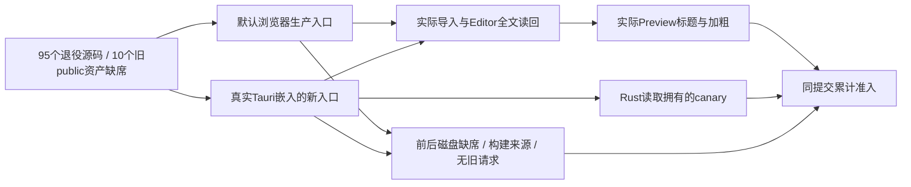

# R16-13 单实现运行

2026-10-25，用户确认“12通过开始13”。12实现59b86ab / CI40134714024七组Windows及全部步骤通过，同提交accepted=true、271风险指纹和两份下载归档摘要核验，正式收尾24fefec。本任务继续codex/r16-stage，仅验证16.13浏览器和Tauri当前入口；阶段16整体待13精确提交验收。用户AGENTS.md既有修改保持且不提交。

## 验证职责与实际入口

scripts/stage-16/single-implementation.mjs统一定义缺席证明、运行观察和同提交准入。根据现有删除清单与冻结模型保护列表检查95个退役源码和10个原public资源，同时检查当前dist中的源路径与public映射路径。旧app/runtime/UI兼容目录中的未知未跟踪文件也会失败；空历史目录允许保留。状态字段改为referenced/protected不能自行豁免，缺少六个必查入口、重复或越界记录失败。所有检查只读，不恢复、删除或清理旧文件。

浏览器累计runner增加一个独立新profile的默认生产入口场景，不启用E2E全局；现有75项及11项浏览器契约全部保留。真实Tauri新增独立原生runner，通过现有隔离WebDriver宿主启动实际嵌入dist的新入口，并读取拥有的磁盘canary证明确实抵达Rust。新测试保留拥有的输入和证据，不添加递归删除操作。

两个环境均通过DevTools持有的实际命令所有者导入中文Markdown，在真实Editor中读回全文，并验证实际Preview标题与加粗渲染。检查唯一App Shell/Editor/Preview、ESM构建入口、默认E2E关闭、业务全局缺席及启动/操作资源中无退役路径。运行前后分别复查磁盘缺席，并在启动前验证构建来源；没有创建页面服务对象、产品调试钩子、替代Editor或恢复旧模块。Inspector只在测试进程持有实际对象，沿用现有集成验证方式。

累计验收强制读取browser-artifacts/r16-13-browser.json和WebView归档的r16-13-native.json，核对精确提交、两端实际运行、前后完整退役路径、原生canary和相同前端构建来源；任一缺失、失败、过时、仿真或不一致都会阻止收尾。此前依赖、模型、安全、保存、大文档、导出和生命周期门槛保持。

产品JS/CSS/HTML/Rust、UI、模型、依赖和持久化格式保持。新宿主从24fefec的src-tauri归档准备，只在隔离副本增加既有测试驱动、测试调试端口及拥有的网络夹具解析；保留457个生产锁定包，使用相同当前dist。复用本地编译缓存，实际编译26.99秒完成；这不等于新实现提交CI验收。

## 验证与状态

新增12项缺席/产物/运行/汇总契约及3项原累计验收拒绝用例。接入前21/24通过，旧累计汇总尚不拒绝新增三类证明失败。接入后23/24通过，唯一失败为代码修改后现行风险指纹正常拒绝漂移。刷新后，相关缺席/同提交/依赖图/命名/删除证据75/75通过；原有同提交场景均保持，新增3项明确拒绝不完整双端证明。

真实本机Tauri默认新入口已通过：旧文件缺席、真实命令导入、Editor全文读回、Preview渲染、无业务/E2E全局及真实Rust canary读取；输入与构建来源前后核对。浏览器累计87/87通过（11契约＋76实际页面；原有75场景保留，新增1默认入口场景），四门禁全过。本地双端汇总在24fefec源码基线上accepted=true，95退役源码/10旧public资产路径前后完全一致，构建摘要7b27e96f2b414c4fb09979bf6942470cf7aabd3a1eaceaa4024bbd7b60bc4a78（473输入、136输出）两端一致。277项现行风险指纹、1111个清单输入、10份保护源码和R12/R15/12历史验收保持；1368路径/594实现候选命名审计无新问题。全仓2847/2847通过（373文件、16目录，失败/取消/跳过0），比12净增15项，没有删减原有测试。阶段16整体和13待精确实现提交Windows累计CI，不提前勾选13；推送后停止CI轮询，由用户提供结果或要求查看。

日志位于系统Temp，统一以mdr-r1613-开头：r12-closeout.log（12收尾检查）、native-prepare.log/native-build.log（隔离宿主）、before-integration.log（接入前拒绝用例）、integrated.log（23/24及指纹漂移）、native.log和native/r12-22-webview（真实Tauri）、browser.log和browser（87/87及实际页面证据）、contracts.log（75/75）、gate-*.log（四门禁）、dual-execution.json（两端汇总）、repository.log及repository/repository-audit（全仓2847/2847）。

## 恢复

可从24fefec逐文件恢复本次测试治理、累计门禁和记录。生产与用户数据没有迁移；拥有的测试宿主和本机证据保留，不清理目录或用户原文。

## 正式验收与阶段16交接（2026-10-25）

实现eade7675e2bfe9a1f4b0a91f05cd0ed49a2b8e5a的[CI40137615204](https://github.com/uniquenesssta/mdr/actions/runs/40137615204)七组Windows及全部步骤成功，同提交accepted=true、277风险指纹一致。实际Node日志2847/2847（373文件、16目录，失败/取消/跳过0）、13专项12、累计拒绝3、Rust301、浏览器11＋76、原生安全/导入8路、大文档4路和导出读回通过。新增双端证明在精确提交验收汇总中accepted=true，95退役源码/10旧public资产缺席、浏览器与真实Tauri及前端构建摘要一致，13正式收尾。

closeout归档12576977928（12440字节）SHA256=6265cfc5af5a35aa5dbf9453858fd6dcb95b47eb08a357ea72be7fda1c2c54ad；WebView归档12577967512（1455138字节）SHA256=02a3fe851fe7afba024bc8b32a1ea67f8b00c18d505fef8180b79aae06eb463a，均已下载核对。

阶段16的13项Atomic验收记录均已核对，清理范围正式收尾：生产清单532文件精确匹配，依赖图588节点/1187边且循环/越界0；99候选缺席、6候选属冻结保护，引用未清/证明不足候选均0；4历史名称和9组同名职责有记录，无未解释复制实现。冻结模型、存储兼容、安全、保存及销毁门槛保持。Git交付没有新增生成物或调试开关；忽略的本机产物、日志和用户原文保留，AGENTS.md用户既有修改不提交。

独立图片菜单真实鼠标关闭后的焦点问题仍开放，见R15-13，交接R17.13桌面交互；修复需先落实适用Figma要求。安装/覆盖升级、关联、真实桌面动作、旧数据、百万字符矩阵和发布结论由R17对应任务验证，阶段16清理收尾不等于产品发布验收。用户只授权R17-01工作区与diff，计划从本收尾提交建立codex/r17-stage；17.2未开始，推送后停止CI轮询。
